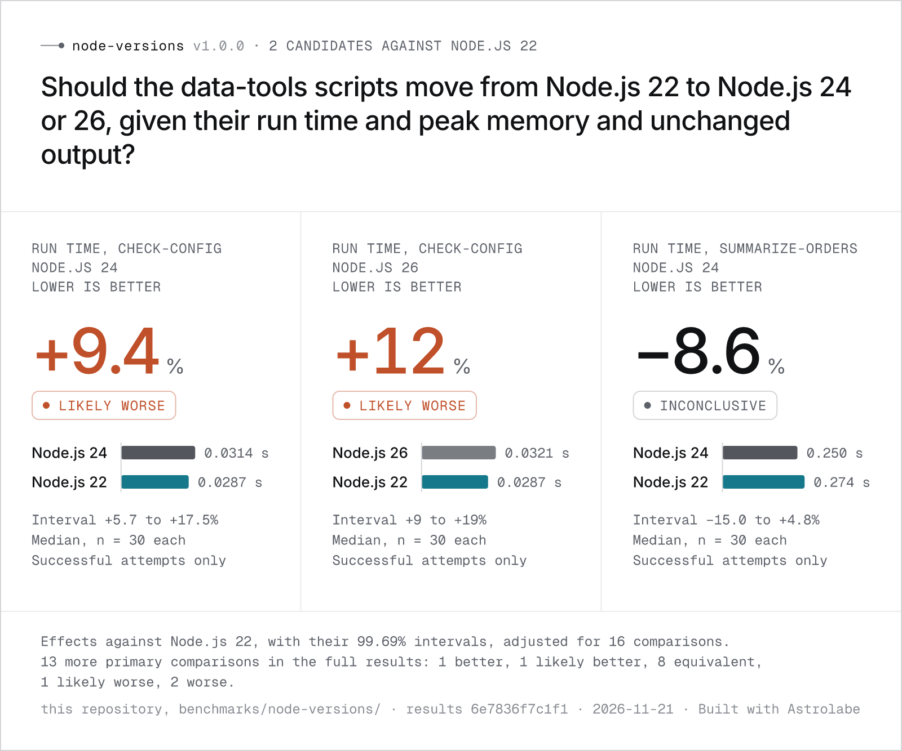
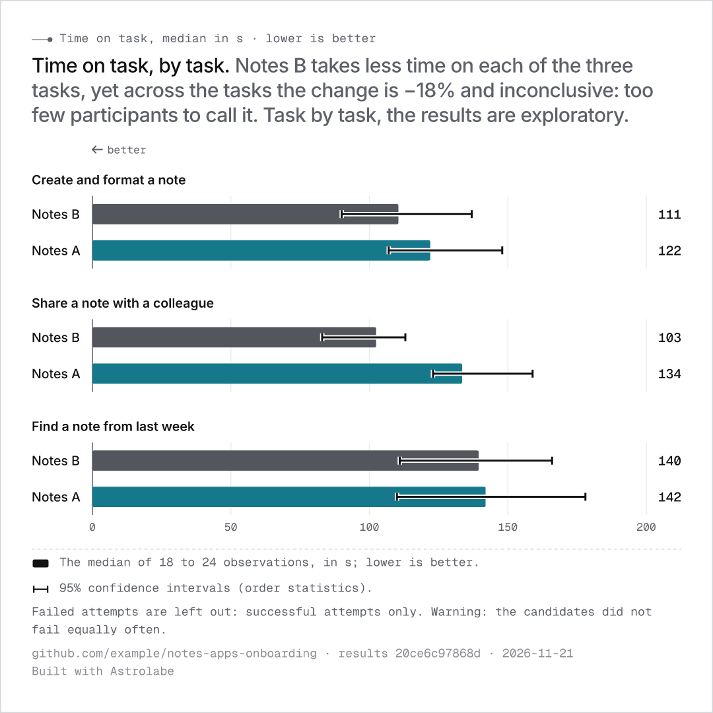

<div align="left">
<h1> <code>Astrolabe</code></h1>

<b>An open benchmark format. Agents measure, the tool computes, anyone can verify.</b>

[](https://www.npmjs.com/package/astrolabe-bench)
[](https://github.com/mavdol/astrolabe/actions/workflows/ci.yml)
[](LICENSE)

</div>

Astrolabe lets your agent run benchmarks and showcase the results. Ask how your options compare for your use case, including whether one is actually better. Your agent designs the comparison, measures the differences, then turns the results into a page, a card for your README and charts.

It combines a skill and a command-line tool. The skill brings together best practices for measurement, statistics and presentation, so the agent has a clear process to follow. The `astrolabe` command computes every number from the raw data and renders the outputs. Since the agent writes code and declarations but never numbers, every claim can be checked.

<table>
  <tr>
    <td valign="top" width="60%" rowspan="2">
      <picture>
        <source media="(prefers-color-scheme: light)" srcset="assets/readme/site-light.png">
        <source media="(prefers-color-scheme: dark)" srcset="assets/readme/site-dark.png">
        
      </picture>
      <br><sub><b>Site</b> · a page to publish, with every chart, table and filter</sub>
    </td>
    <td valign="top" width="40%">
      <picture>
        <source media="(prefers-color-scheme: light)" srcset="assets/readme/card-light.png">
        <source media="(prefers-color-scheme: dark)" srcset="assets/readme/card-dark.png">
        
      </picture>
      <br><sub><b>README</b> · a card linked to a full Markdown report</sub>
    </td>
  </tr>
  <tr>
    <td valign="top" width="40%">
      <picture>
        <source media="(prefers-color-scheme: light)" srcset="assets/readme/chart-time-on-task-light.png">
        <source media="(prefers-color-scheme: dark)" srcset="assets/readme/chart-time-on-task-dark.png">
        
      </picture>
      <br><sub><b>Chart images</b> · PNG or SVG, for posts and slides</sub>
    </td>
  </tr>
</table>

## Getting started

Install the skill, then ask your agent to compare options, benchmark a change, or report on results you already have. The agent loads the skill automatically for these requests. If your project doesn't have the `astrolabe` command yet, the agent adds it after asking you. The command requires Node.js 22 or later.

**Claude Code plugin**

```bash
claude plugin install astrolabe --marketplace mavdol/astrolabe
```

> Or add the marketplace with `/plugin marketplace add mavdol/astrolabe` and find the plugin under `/plugin`.

**Any agent that implements the [Agent Skills specification](https://agentskills.io)**

```bash
npx skills add mavdol/astrolabe
```

Or install the package and run `init` yourself:

```bash
npm install --save-dev astrolabe-bench
npx --no-install astrolabe init   # copies the skill into .agents/skills/, or --dir <your agent's skills folder>
```

**Manually**

Copy [`skills/astrolabe-benchmark/`](skills/astrolabe-benchmark) into your agent's skills folder, such as `.agents/skills/` or `.claude/skills/`.

> [!TIP]
> Use a mid-range model or better, such as Claude Sonnet or its equivalent. Smaller models, such as Claude Haiku, load the skill less reliably and may skip steps.

## Open format

Each benchmark is a single `benchmark.json`, holding the plan, the results computed from the raw data and the page to render, described by a [JSON Schema](skills/astrolabe-benchmark/benchmark.schema.json) and shown in a [complete example](skills/astrolabe-benchmark/example.benchmark.json).

## Contributing

Contributions are welcome: bug reports, fixes to the skill or the command, new examples. For a larger change, open an issue first so we can agree on the approach.

### Development

```bash
pnpm install
pnpm test
pnpm typecheck
pnpm lint
pnpm build
pnpm gen:schema         # after changing src/schema/
pnpm gen:example-data   # rewrite the synthetic raw files of examples/
```

### Evaluations

The skill is tested on real model runs with `claude plugin eval`:

```bash
scripts/run-evals.sh --quick          # four short cases, with and without the skill
scripts/run-evals.sh --triggering     # requests that should, or should not, load the skill
scripts/review-skill-pr.sh <number>   # a pull request's skill against main's
```

> [!IMPORTANT]
> Each run is a real model call, paid by your own Claude account or API key. The script shows a cost ceiling and starts only once you confirm.

Change the evaluations and their graders in a pull request of their own, not with a change to the skill, so each is measured against the other.

## License

MIT, see [LICENSE](LICENSE).
