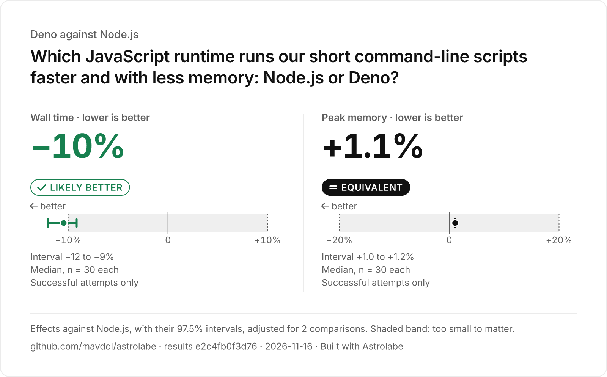
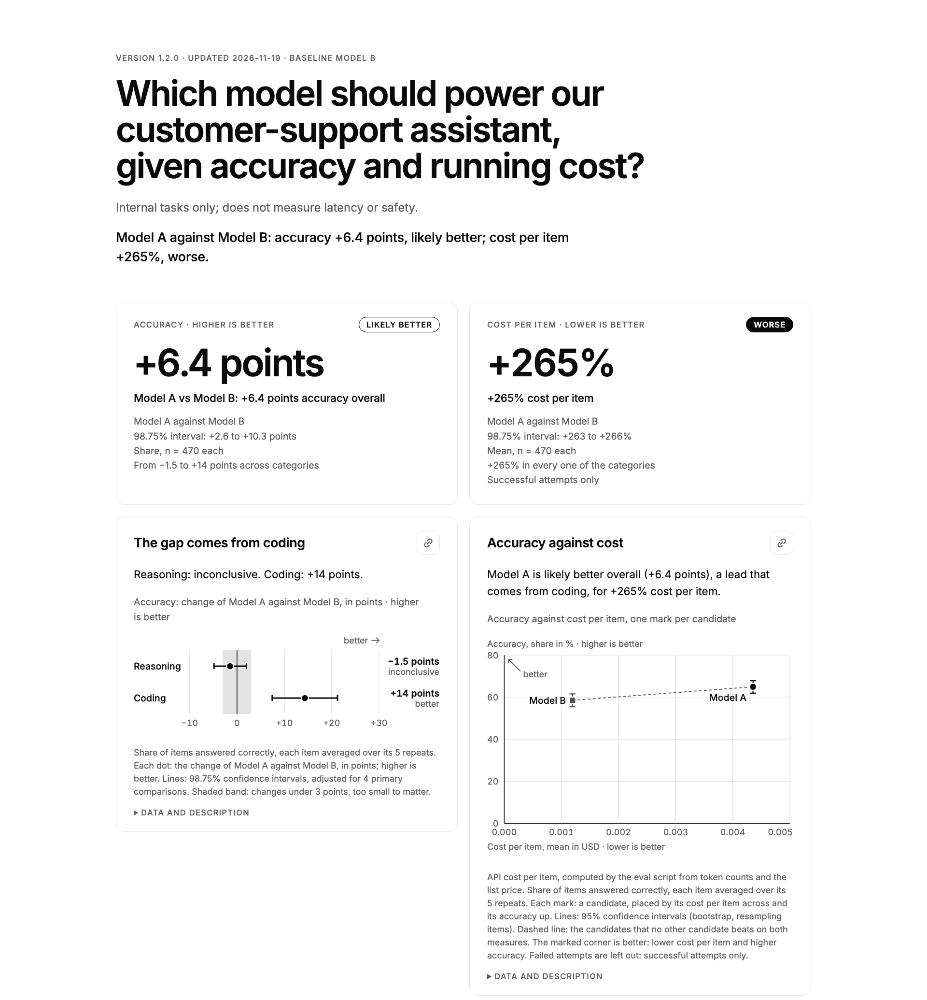
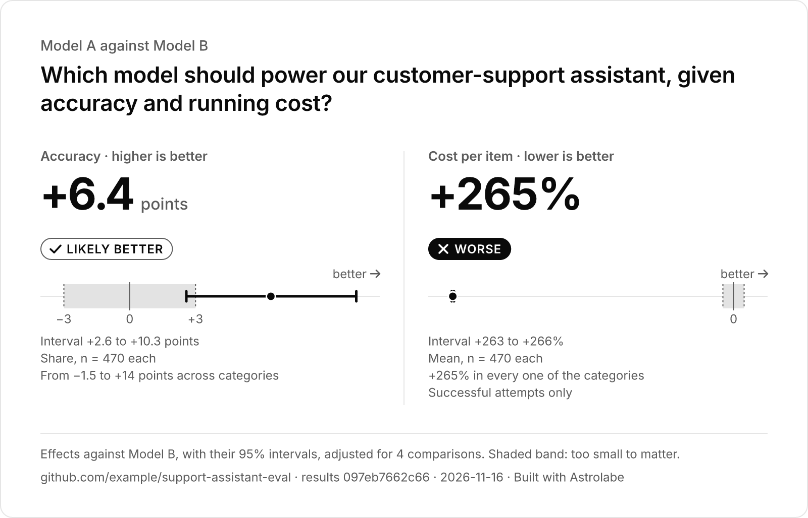
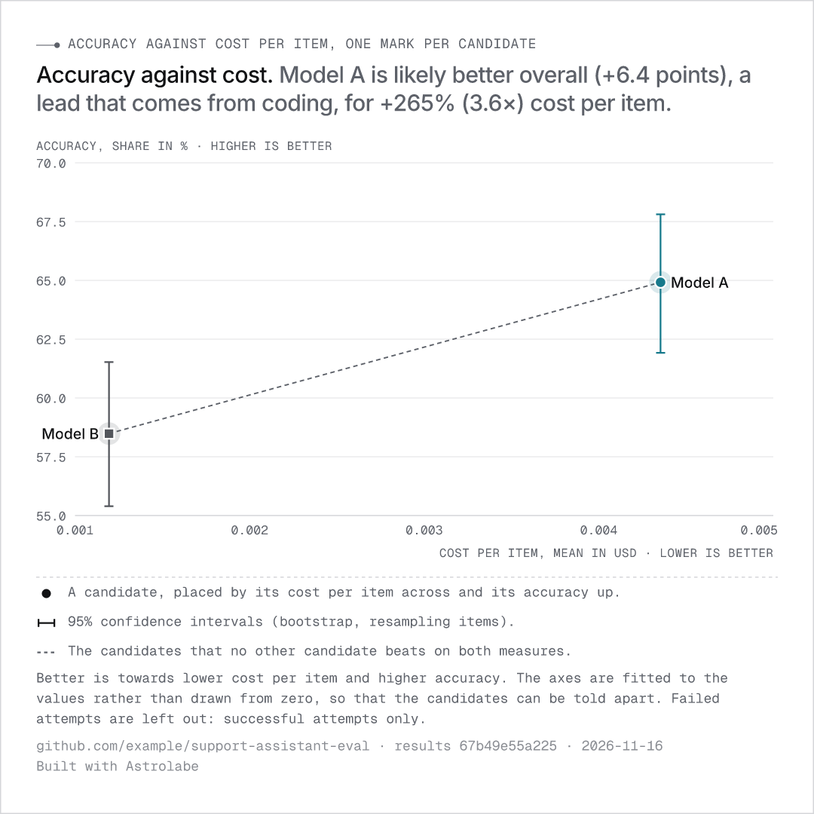

<div align="center">
<h1> ҉Astrolabe</h1>

<b>An agent-native framework to run and showcase benchmarks.</b>

[](https://www.npmjs.com/package/astrolabe-bench)
[](https://github.com/mavdol/astrolabe/actions/workflows/ci.yml)
[](LICENSE)
</div>

<p align="center">
<a href="examples/js-runtimes/dist/benchmark.md">
<picture>
  <source media="(prefers-color-scheme: light)" srcset="examples/js-runtimes/dist/exports/readme-card-light.svg">
  <source media="(prefers-color-scheme: dark)" srcset="examples/js-runtimes/dist/exports/readme-card-dark.svg">
  
</picture>
</a>
</p>

Astrolabe lets your agent run benchmarks you can trust. Ask which library is faster or which prompt works better, and your agent measures it fairly, then publishes the results as a page, a README card and charts.

A skill teaches the agent the method, and the `astrolabe` command computes every number from the raw data. Nothing is typed by hand, so every claim can be checked.

<table>
  <tr>
    <td valign="top" width="60%" rowspan="2">
      <picture>
        <source media="(prefers-color-scheme: light)" srcset="assets/readme/site-light.png">
        <source media="(prefers-color-scheme: dark)" srcset="assets/readme/site-dark.png">
        
      </picture>
      <br><b>Site</b> · <sub>a page to publish, with every chart, table and filter</sub>
    </td>
    <td valign="top" width="40%">
      <a href="examples/support-assistant-eval/dist/benchmark.md">
        <picture>
          <source media="(prefers-color-scheme: light)" srcset="examples/support-assistant-eval/dist/exports/readme-card-light.svg">
          <source media="(prefers-color-scheme: dark)" srcset="examples/support-assistant-eval/dist/exports/readme-card-dark.svg">
          
        </picture>
      </a>
      <br><b>README</b> · <sub>a card linked to a full Markdown report</sub>
    </td>
  </tr>
  <tr>
    <td valign="top" width="40%">
      
      <br><b>Chart images</b> · <sub>PNG or SVG, for posts and slides</sub>
    </td>
  </tr>
</table>

## ◌ Skill & Install

Your agent loads the skill when you ask it to compare or benchmark something, or to report on results you already have. If your project doesn't have the `astrolabe` command yet, the skill adds it, after asking you. It needs Node.js 22 or later.

**Claude Code plugin**

```bash
claude plugin install astrolabe --marketplace mavdol/astrolabe
```

Or add the marketplace with `/plugin marketplace add mavdol/astrolabe` and find the plugin under `/plugin`.

**Any agent that reads Agent Skills**

```bash
npx skills add mavdol/astrolabe
```

or

```bash
npm install --save-dev astrolabe-bench
npx --no-install astrolabe init   # copies the skill into .agents/skills/, or --dir <your agent's skills folder>
```

**Manually**

Copy [`skills/astrolabe-benchmark/`](skills/astrolabe-benchmark) into your agent's skills folder, such as `.agents/skills/` or `.claude/skills/`.

> [!TIP]
> Use a mid-range model or better, such as Claude Sonnet or its equivalent. Smaller models, such as Haiku, load the skill less reliably and skip steps.

## Contributing

```bash
pnpm install
pnpm test
pnpm typecheck
pnpm lint
pnpm build
pnpm gen:schema         # after changing src/schema/
pnpm gen:example-data   # rewrite the synthetic raw files of examples/
```

The skill is tested on real model runs with `claude plugin eval`:

```bash
scripts/run-evals.sh --quick          # four short cases, with and without the skill
scripts/run-evals.sh --triggering     # requests that should, or should not, load the skill
scripts/review-skill-pr.sh <number>   # a pull request's skill against main's
```

> [!IMPORTANT]
> Each run is a real model call, paid by your own Claude account or API key. The script shows a cost ceiling and starts only once you confirm.

Change the evaluations and their graders in a pull request of their own, not with a change to the skill, so each is measured against the other.

## License

MIT, see [LICENSE](LICENSE).
