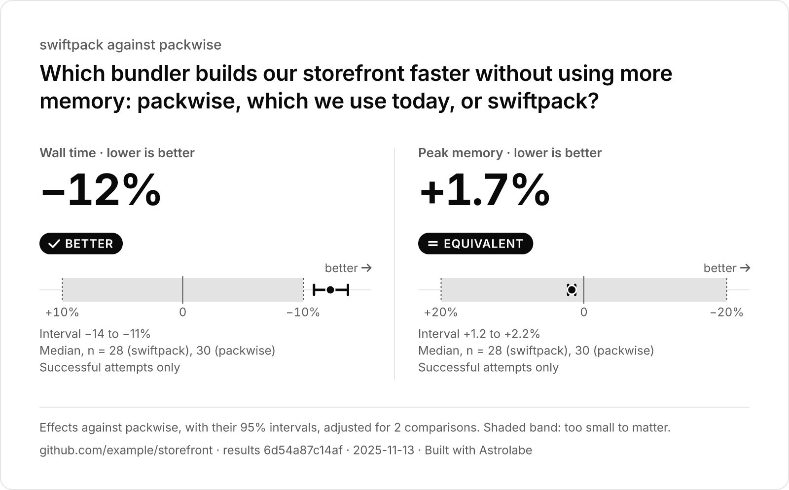

# storefront

The storefront web app. `npm run build` bundles it with packwise.

## Bundler benchmark

We measured swiftpack against packwise, our current bundler, before deciding whether to switch. Full results: [benchmarks/bundlers/dist/benchmark.md](benchmarks/bundlers/dist/benchmark.md).

<a href="benchmarks/bundlers/dist/benchmark.md">
<picture>
  <source media="(prefers-color-scheme: light)" srcset="benchmarks/bundlers/dist/exports/readme-card-light.svg">
  <source media="(prefers-color-scheme: dark)" srcset="benchmarks/bundlers/dist/exports/readme-card-dark.svg">
  
</picture>
</a>
