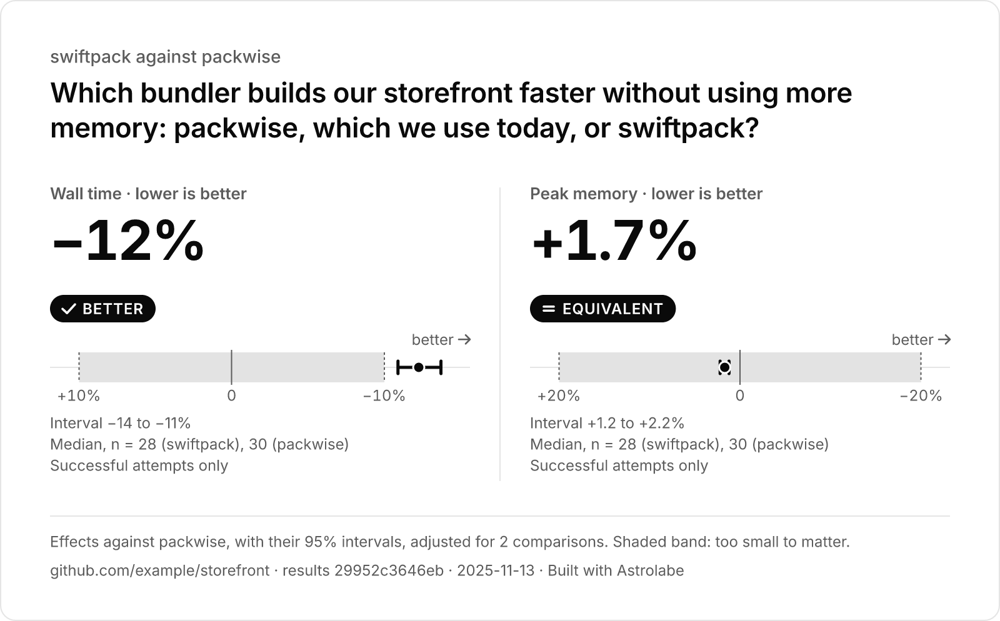

# Which bundler builds our storefront faster without using more memory: packwise, which we use today, or swiftpack?

Full production build of the storefront from a warm cache, on a developer laptop.

<picture>
  <source media="(prefers-color-scheme: light)" srcset="exports/readme-card-light.svg">
  <source media="(prefers-color-scheme: dark)" srcset="exports/readme-card-dark.svg">
  
</picture>

Benchmark `bundlers`, version 1.0.0. Baseline: packwise.

## Results

### Wall time

Elapsed time of one full production build, process start-up included, as measured by hyperfine without a shell. The median, in s; lower is better. Intervals: 95%, by order statistics. Failed attempts are left out: values cover successful attempts only.

| Candidate | Median (s) | 95% interval | n | Failures |
| --- | ---: | ---: | ---: | ---: |
| packwise (baseline) | 2.39 | 2.37 to 2.42 | 30 | 0 |
| swiftpack | 2.10 | 2.07 to 2.12 | 28 | 2 of 30 |

### Peak memory

Peak resident set size of the process, as reported by hyperfine. The median, in MiB; lower is better. Intervals: 95%, by order statistics. Failed attempts are left out: values cover successful attempts only.

| Candidate | Median (MiB) | 95% interval | n | Failures |
| --- | ---: | ---: | ---: | ---: |
| packwise (baseline) | 411.3 | 410.3 to 412.6 | 30 | 0 |
| swiftpack | 418.2 | 417.3 to 419.6 | 28 | 2 of 30 |

## Against packwise

Each candidate against the baseline, packwise. A verdict is read from the interval of the effect and the smallest difference that matters to the author: better or worse when the interval lies past it, likely when the direction is clear but the size may fall short, equivalent when the interval lies inside it, inconclusive otherwise. These are the claims of the benchmark. Their intervals are widened together for the 2 comparisons (Bonferroni), so they hold jointly.

| Comparison | Effect | Interval | Verdict | Notes |
| --- | ---: | ---: | --- | --- |
| swiftpack, wall time | −12% | −14 to −11% (97.5%) | better | successful attempts only |
| swiftpack, peak memory | +1.7% | +1.2 to +2.2% (97.5%) | equivalent | successful attempts only |

## Method

- Computed from raw data by astrolabe: Wall time, Peak memory.
- Comparisons: 2 primary, 0 exploratory.
- Observed: build 30 (planned 30).
- Warm-up: 2 untimed builds per bundler; state: warm.
- Order: hyperfine runs the 30 builds of one bundler, then the other.
- Declared conditions: none declared.
- Workload: Full production build of the storefront: 1,800 modules, TypeScript and CSS. One build per merge on the CI runner, warm cache.

### Candidates

Declared by the author.

**packwise (baseline)**, version 4.2.0

- Configuration: command node scripts/build-with.mjs packwise; cache warm
- Publication terms: MIT licence, read at https://packwise.example/license on 2026-11-10. Restriction on publishing results: none found
- Variants tried: none other than the one measured

**swiftpack**, version 1.9.3

- Configuration: command node scripts/build-with.mjs swiftpack; cache warm
- Publication terms: MIT licence, read at https://swiftpack.example/license on 2026-11-10. Restriction on publishing results: none found
- Variants tried: none other than the one measured

### Environment

- Hardware: Apple M2, 8 cores, 8 GB RAM
- Os: macOS 26.6.2
- Software: node 22.14.0, packwise 4.2.0, swiftpack 1.9.3, hyperfine 2.0.0
- Background: Not controlled: a developer laptop with its usual background processes
- Tools: hyperfine

### Limitations

- One project and one laptop; a CI runner with fewer cores may rank the bundlers differently.
- Warm cache only: cold builds were not measured.

---

results sha256 `6d54a87c14af` · 2025-11-13 · source https://github.com/example/storefront · built with astrolabe-bench 0.1.0
