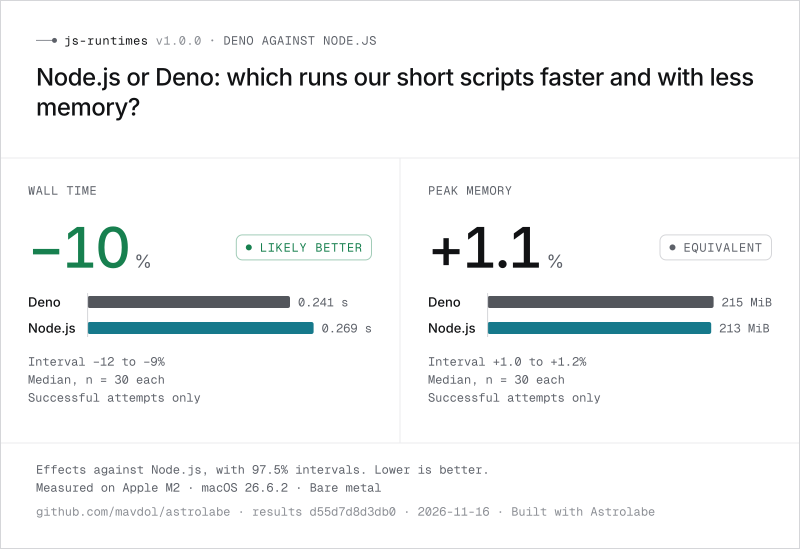

# Which JavaScript runtime runs our short command-line scripts faster and with less memory: Node.js or Deno?

One process per run, start-up included, on a short CPU-bound script; not a measure of long-running servers.

<picture>
  <source media="(prefers-color-scheme: dark)" srcset="exports/readme-card-dark.svg">
  
</picture>

Benchmark `js-runtimes`, version 1.0.0. Baseline: Node.js.

## Results

### Wall time

Elapsed time of one process running workload.mjs, start-up included, as measured by hyperfine without a shell. The median, in s; lower is better. Intervals: 95%, by order statistics. Failed attempts are left out: values cover successful attempts only.

| Candidate | Median (s) | 95% interval | n | Failures |
| --- | ---: | ---: | ---: | ---: |
| Node.js (baseline) | 0.269 | 0.266 to 0.273 | 30 | 0 |
| Deno | 0.241 | 0.238 to 0.243 | 30 | 0 |

### Peak memory

Peak resident set size of the process, as reported by hyperfine. The median, in MiB; lower is better. Intervals: 95%, by order statistics. Failed attempts are left out: values cover successful attempts only.

| Candidate | Median (MiB) | 95% interval | n | Failures |
| --- | ---: | ---: | ---: | ---: |
| Node.js (baseline) | 212.88 | 212.81 to 212.92 | 30 | 0 |
| Deno | 215.17 | 215.05 to 215.34 | 30 | 0 |

## Against Node.js

Each candidate against the baseline, Node.js. A verdict is read from the interval of the effect and the smallest difference that matters to the author: better or worse when the interval lies past it, likely when the direction is clear but the size may fall short, equivalent when the interval lies inside it, inconclusive otherwise. These are the claims of the benchmark. Their intervals are widened together for the 2 comparisons (Bonferroni), so they hold jointly.

| Comparison | Effect | Interval | Verdict | Notes |
| --- | ---: | ---: | --- | --- |
| Deno, wall time | −10% | −12 to −9% (97.5%) | likely better | successful attempts only |
| Deno, peak memory | +1.1% | +1.0 to +1.2% (97.5%) | equivalent | successful attempts only |

## Method

- Computed from raw data by astrolabe: Wall time, Peak memory.
- Comparisons: 2 primary, 0 exploratory.
- Observed: process 30 (planned 30).
- Warm-up: 3 untimed runs per runtime before each round; state: warm.
- Order: 3 rounds of 10 runs; the order of the runtimes alternates between rounds, and hyperfine runs each runtime's runs consecutively within a round.
- Declared conditions: none declared.
- Workload: workload.mjs builds 200,000 records, serializes them to JSON, parses them back, sorts and sums them.

### Environment

- Hardware: Apple M2, 8 cores, 8 GB RAM
- Os: macOS 26.6.2
- Software: node 22.14.0, deno 2.5.6, hyperfine 2.0.0
- Background: Not controlled: a developer laptop with its usual background processes
- Tools: hyperfine

### Limitations

- One machine and one workload; a different script or a server workload may rank the runtimes differently.
- Bun is not included: it was not installed on the measuring machine.
- Within a round, the runs of one runtime are consecutive, so a slow drift of the machine can favour one runtime; alternating the order between rounds limits it.

---

results sha256 `b428a3a9ef72` · 2026-11-15 · source https://github.com/mavdol/astrolabe · built with astrolabe-bench 0.1.0
