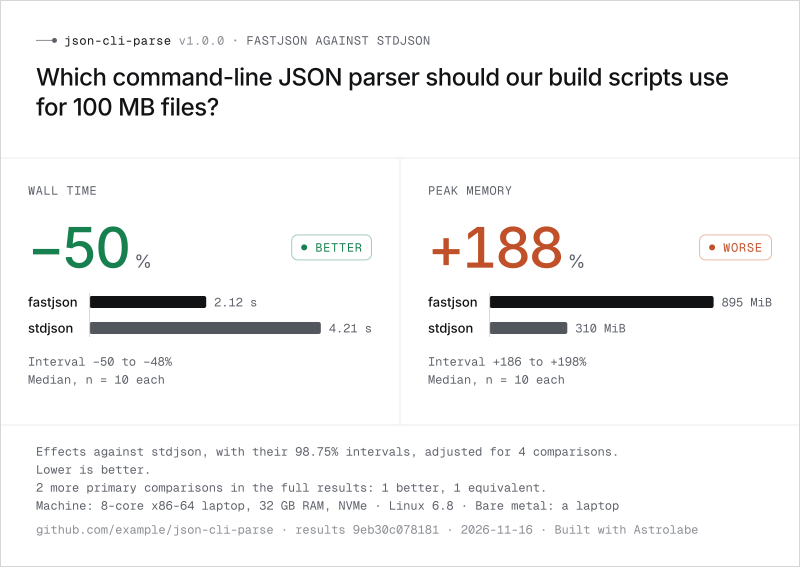

# Which command-line JSON parser should our build scripts use for 100 MB files?

<picture>
  <source media="(prefers-color-scheme: dark)" srcset="exports/readme-card-dark.svg">
  
</picture>

Benchmark `json-cli-parse`, version 1.0.0. Baseline: stdjson.

## Results

### Wall time

Elapsed time of one process parsing and re-serializing the file, start-up included. The median, in s; lower is better. Intervals: 95%, by order statistics.

| Candidate | Median (s) | 95% interval | n | Failures |
| --- | ---: | ---: | ---: | ---: |
| stdjson (baseline) | 4.21 | 4.08 to 4.25 | 10 | 0 |
| fastjson | 2.12 | 2.09 to 2.14 | 10 | 0 |
| tinyjson | 4.02 | 3.90 to 4.09 | 10 | 0 |

### Peak memory

Peak resident set size of the process. The median, in MiB; lower is better. Intervals: 95%, by order statistics.

| Candidate | Median (MiB) | 95% interval | n | Failures |
| --- | ---: | ---: | ---: | ---: |
| stdjson (baseline) | 310.3 | 302.6 to 312.0 | 10 | 0 |
| fastjson | 894.8 | 887.6 to 908.1 | 10 | 0 |
| tinyjson | 117.8 | 116.9 to 119.6 | 10 | 0 |

## Against stdjson

Each candidate against the baseline, stdjson. A verdict is read from the interval of the effect and the smallest difference that matters to the author: better or worse when the interval lies past it, likely when the direction is clear but the size may fall short, equivalent when the interval lies inside it, inconclusive otherwise. These are the claims of the benchmark. Their intervals are widened together for the 4 comparisons (Bonferroni), so they hold jointly.

| Comparison | Effect | Interval | Verdict | Notes |
| --- | ---: | ---: | --- | --- |
| fastjson, wall time | −50% | −50 to −48% (98.75%) | better |  |
| tinyjson, wall time | −4.3% | −7.1 to −1.5% (98.75%) | equivalent |  |
| fastjson, peak memory | +188% | +186 to +198% (98.75%) | worse |  |
| tinyjson, peak memory | −62% | −62 to −61% (98.75%) | better |  |

## Method

- Computed from raw data by astrolabe: Wall time, Peak memory.
- Comparisons: 4 primary, 0 exploratory.
- Observed: process 10 (planned 10).
- Warm-up: 3 untimed runs to fill the file cache; state: warm.
- Order: interleaved, randomized.
- Declared conditions: none declared.
- Workload: One 100 MB file of real build metadata, 1.2 million objects.

### Environment

- Hardware: 8-core x86-64 laptop, 32 GB RAM, NVMe
- Os: Linux 6.8
- Software: hyperfine 1.19
- Background: No other user process; checked with top before each batch
- Tools: hyperfine

### Limitations

- One file size and one machine; no cold-cache measurement.
- Multi-threaded mode of fastjson was tried but not kept, since build scripts run single-threaded.

---

results sha256 `21790008b158` · 2026-11-16 · source https://github.com/example/json-cli-parse · built with astrolabe-bench 0.1.0
