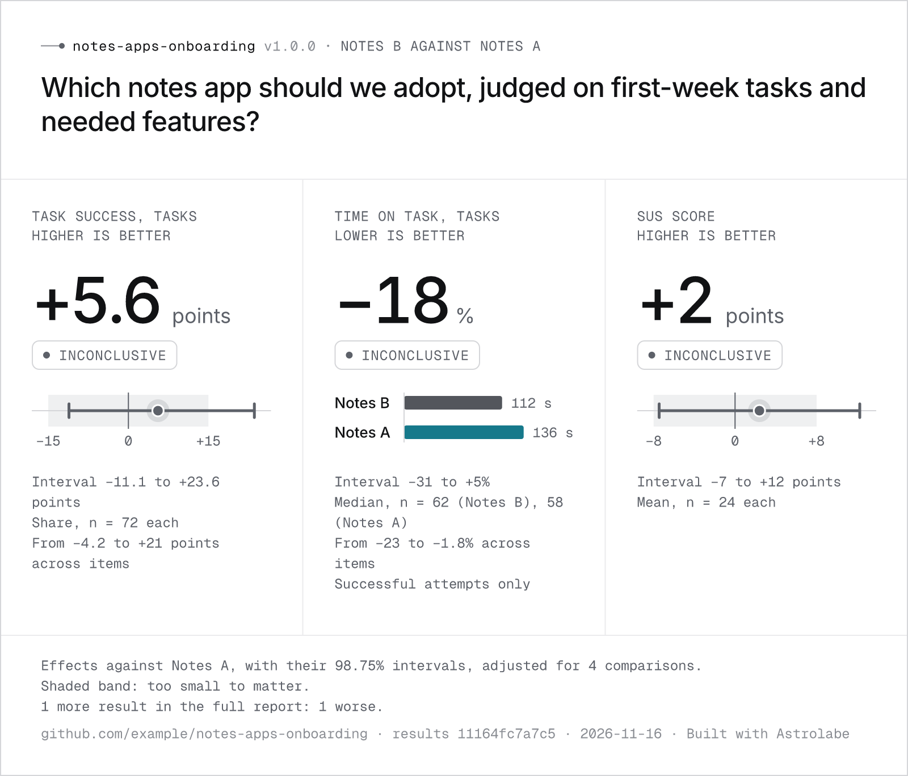

# Which notes app should we adopt, judged on first-week tasks and needed features?

<picture>
  <source media="(prefers-color-scheme: light)" srcset="exports/readme-card-light.svg">
  <source media="(prefers-color-scheme: dark)" srcset="exports/readme-card-dark.svg">
  
</picture>

Benchmark `notes-apps-onboarding`, version 1.0.0. Baseline: Notes A.

## Results

### Task success

Share of participants completing the task unaided within 5 minutes. The share, in %; higher is better. Intervals: 95%, by bootstrap, resampling items, or by Wilson score. Failed attempts count as zero.

| Node | Candidate | Share (%) | 95% interval | n | Failures |
| --- | --- | ---: | ---: | ---: | ---: |
| &emsp;Tasks | Notes A (baseline) | 81 | 71 to 89 | 72 | 14 in total |
| &emsp;Tasks | Notes B | 86 | 76 to 94 | 72 | 10 in total |
| &emsp;&emsp;Create and format a note | Notes A (baseline) | 79 | 60 to 91 | 24 | 5 of 24 |
| &emsp;&emsp;Create and format a note | Notes B | 100 | 86 to 100 | 24 | 0 |
| &emsp;&emsp;Share a note with a colleague | Notes A (baseline) | 83 | 64 to 93 | 24 | 4 of 24 |
| &emsp;&emsp;Share a note with a colleague | Notes B | 83 | 64 to 93 | 24 | 4 of 24 |
| &emsp;&emsp;Find a note from last week | Notes A (baseline) | 79 | 60 to 91 | 24 | 5 of 24 |
| &emsp;&emsp;Find a note from last week | Notes B | 75 | 55 to 88 | 24 | 6 of 24 |

### Time on task

Time per task, successful attempts only. The median, in s; lower is better. Intervals: 95%, by bootstrap, resampling items, or by order statistics. Failed attempts are left out: values cover successful attempts only.

| Node | Candidate | Median (s) | 95% interval | n | Failures |
| --- | --- | ---: | ---: | ---: | ---: |
| &emsp;Tasks | Notes A (baseline) | 136 | 120 to 147 | 58 | 14 in total |
| &emsp;Tasks | Notes B | 112 | 100 to 129 | 62 | 10 in total |
| &emsp;&emsp;Create and format a note | Notes A (baseline) | 122 | 107 to 148 | 19 | 5 of 24 |
| &emsp;&emsp;Create and format a note | Notes B | 111 | 90 to 137 | 24 | 0 |
| &emsp;&emsp;Share a note with a colleague | Notes A (baseline) | 134 | 123 to 159 | 20 | 4 of 24 |
| &emsp;&emsp;Share a note with a colleague | Notes B | 103 | 83 to 113 | 20 | 4 of 24 |
| &emsp;&emsp;Find a note from last week | Notes A (baseline) | 142 | 110 to 178 | 19 | 5 of 24 |
| &emsp;&emsp;Find a note from last week | Notes B | 140 | 111 to 166 | 18 | 6 of 24 |

### SUS score

System Usability Scale, 0 to 100, filled in after the three tasks. The mean, in points; higher is better. Intervals: 95%, by Student's t.

| Node | Candidate | Mean (points) | 95% interval | n | Failures |
| --- | --- | ---: | ---: | ---: | ---: |
| Onboarding study | Notes A (baseline) | 73 | 66 to 79 | 24 | 0 |
| Onboarding study | Notes B | 75 | 71 to 79 | 24 | 0 |

### Feature coverage

Present 100, partial 50, absent 0; each verified by using it. The share, in %; higher is better. Declared by the author, not computed from raw data.

| Node | Candidate | Share (%) | 95% interval | n | Failures |
| --- | --- | ---: | ---: | ---: | ---: |
| &emsp;Features | Notes A (baseline) | 83 (declared) | — | 3 | — |
| &emsp;Features | Notes B | 67 (declared) | — | 3 | — |
| &emsp;&emsp;Offline editing | Notes A (baseline) | 100 (declared) | — | 1 | — |
| &emsp;&emsp;Offline editing | Notes B | 0 (declared) | — | 1 | — |
| &emsp;&emsp;Markdown export | Notes A (baseline) | 100 (declared) | — | 1 | — |
| &emsp;&emsp;Markdown export | Notes B | 100 (declared) | — | 1 | — |
| &emsp;&emsp;Live co-editing | Notes A (baseline) | 50 (declared) | — | 1 | — |
| &emsp;&emsp;Live co-editing | Notes B | 100 (declared) | — | 1 | — |

## Against Notes A

Each candidate against the baseline, Notes A. A verdict is read from the interval of the effect and the smallest difference that matters to the author: better or worse when the interval lies past it, likely when the direction is clear but the size may fall short, equivalent when the interval lies inside it, inconclusive otherwise. These are the claims of the benchmark. Their intervals are widened together for the 4 comparisons (Bonferroni), so they hold jointly.

| Comparison | Effect | Interval | Verdict | Notes |
| --- | ---: | ---: | --- | --- |
| Notes B, task success, Tasks | +5.6 points | −11.1 to +23.6 points (98.75%) | inconclusive |  |
| Notes B, time on task, Tasks | −18% | −31 to +5% (98.75%) | inconclusive | successful attempts only |
| Notes B, SUS score, Onboarding study | +2 points | −7 to +12 points (98.75%) | inconclusive |  |
| Notes B, feature coverage, Features | −17 points | — | worse | declared values |

### Exploratory comparisons

Not declared before measuring and not adjusted for the number of comparisons: some of these verdicts can appear by chance, and none is a claim of the benchmark.

| Comparison | Effect | Interval | Verdict | Notes |
| --- | ---: | ---: | --- | --- |
| Notes B, task success, Create and format a note | +21 points | +3 to +38 points (95%) | likely better |  |
| Notes B, task success, Share a note with a colleague | 0 points | −22 to +22 points (95%) | inconclusive |  |
| Notes B, task success, Find a note from last week | −4.2 points | −29.1 to +20.8 points (95%) | inconclusive |  |
| Notes B, time on task, Create and format a note | −9.4% | −31.5 to +14.8% (95%) | inconclusive | successful attempts only; warning: the candidates did not fail equally often; see the failures |
| Notes B, time on task, Share a note with a colleague | −23% | −38 to −15% (95%) | likely better | successful attempts only |
| Notes B, time on task, Find a note from last week | −1.8% | −27.4 to +21.4% (95%) | inconclusive | successful attempts only |
| Notes B, feature coverage, Offline editing | −100 points | — | worse | declared values |
| Notes B, feature coverage, Markdown export | 0 points | — | equivalent | declared values |
| Notes B, feature coverage, Live co-editing | +50 points | — | better | declared values |

## Method

- Computed from raw data by astrolabe: Task success, Time on task, SUS score. Declared by the author: Feature coverage.
- Comparisons: 4 primary, 9 exploratory.
- Observed: participant 24 (planned 24).
- Order: apps assigned at random; task order rotated.
- Declared conditions: none declared.
- Workload: Three tasks from a new employee's first week, and three required features. Moderated remote sessions of 30 minutes.
- Tasks: Create and format a note: title, list, image; Share a note with a named colleague, edit rights; Find a note written last week from two keywords.
- Users: 48 office workers who had used neither app, 24 per app.

### Candidates

Declared by the author.

**Notes A (baseline)**, version 7.2 (web)

- Configuration: plan team; onboarding default
- Publication terms: terms of service, 2026-05, read at https://example.com/notes_a/terms on 2026-11-02. Restriction on publishing results: none found
- Variants tried: none other than the one measured

**Notes B**, version 3.14 (web)

- Configuration: plan team; onboarding default
- Publication terms: terms of service, 2026-08, read at https://example.com/notes_b/terms on 2026-11-02. Restriction on publishing results: none found
- Variants tried: none other than the one measured

### Environment

- Setting: Remote sessions, participant's own laptop, Chrome 142
- Moderation: Same script and moderator for both apps

### Limitations

- 24 participants per app: enough to compare, but intervals stay wide.
- Web versions only; mobile apps were not tested.
- Three features chosen by the team; other features were not checked.

---

results sha256 `11164fc7a7c5` · 2026-11-16 · source https://github.com/example/notes-apps-onboarding · built with astrolabe-bench 0.1.0
