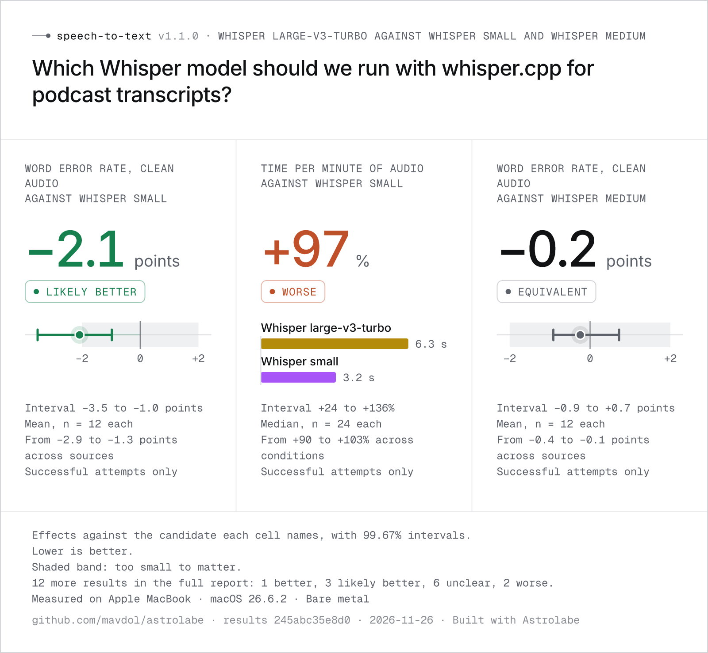

# Which Whisper model should we run with whisper.cpp for podcast transcripts?

English speech transcribed offline by whisper.cpp 1.9.6 on one Apple M2 laptop with 8 GB, Metal GPU on, default decoding. Accuracy is word error rate against human transcripts on 24 excerpts of about 100 s from four freely licensed corpora: clean read speech, headset-recorded meetings, the same meetings from a room microphone, and accented earnings calls. Speed is the whole whisper-cli process per minute of audio. Says nothing about other languages, other machines, quantized models, speaker labels, punctuation or timestamps.

<picture>
  <source media="(prefers-color-scheme: light)" srcset="exports/readme-card-light.svg">
  <source media="(prefers-color-scheme: dark)" srcset="exports/readme-card-dark.svg">
  
</picture>

Benchmark `speech-to-text`, version 1.1.0. Baseline: Whisper small.

## Results

### Word error rate

Per excerpt, (substituted + deleted + inserted words) / reference words, in percent, after the Whisper English text normalizer on both the human transcript and the model output (jiwer 4.0). A failed process is scored on an empty transcript (100%). Averaged over excerpts. The mean, in %; lower is better. Intervals: 95%, by bootstrap, resampling clusters. Failed attempts are left out: values cover successful attempts only.

| Node | Candidate | Mean (%) | 95% interval | n | Failures |
| --- | --- | ---: | ---: | ---: | ---: |
| All 24 excerpts | Whisper small (baseline) | 18.2 | 14.7 to 22.1 | 24 | 0 |
| All 24 excerpts | Whisper tiny | 24.9 | 21.5 to 28.8 | 24 | 0 |
| All 24 excerpts | Whisper base | 20.3 | 17.2 to 23.6 | 24 | 0 |
| All 24 excerpts | Whisper medium | 15.4 | 12.6 to 18.5 | 24 | 0 |
| All 24 excerpts | Whisper large-v3-turbo | 17.1 | 11.8 to 25.2 | 24 | 0 |
| &emsp;Clean audio | Whisper small (baseline) | 9.8 | 8.8 to 10.9 | 12 | 0 |
| &emsp;Clean audio | Whisper tiny | 13.6 | 11.7 to 15.5 | 12 | 0 |
| &emsp;Clean audio | Whisper base | 11.1 | 9.6 to 12.6 | 12 | 0 |
| &emsp;Clean audio | Whisper medium | 8.0 | 6.9 to 9.1 | 12 | 0 |
| &emsp;Clean audio | Whisper large-v3-turbo | 7.8 | 6.7 to 8.9 | 12 | 0 |
| &emsp;&emsp;Read audiobooks | Whisper small (baseline) | 2.3 | 1.6 to 3.3 | 6 | 0 |
| &emsp;&emsp;Read audiobooks | Whisper tiny | 4.9 | 2.8 to 7.1 | 6 | 0 |
| &emsp;&emsp;Read audiobooks | Whisper base | 3.0 | 1.6 to 4.7 | 6 | 0 |
| &emsp;&emsp;Read audiobooks | Whisper medium | 1.4 | 0.7 to 2.0 | 6 | 0 |
| &emsp;&emsp;Read audiobooks | Whisper large-v3-turbo | 1.1 | 0.5 to 1.6 | 6 | 0 |
| &emsp;&emsp;Meetings, headset mics | Whisper small (baseline) | 17.3 | 15.6 to 19.2 | 6 | 0 |
| &emsp;&emsp;Meetings, headset mics | Whisper tiny | 22.3 | 19.6 to 25.3 | 6 | 0 |
| &emsp;&emsp;Meetings, headset mics | Whisper base | 19.1 | 16.8 to 21.5 | 6 | 0 |
| &emsp;&emsp;Meetings, headset mics | Whisper medium | 14.6 | 12.6 to 16.5 | 6 | 0 |
| &emsp;&emsp;Meetings, headset mics | Whisper large-v3-turbo | 14.4 | 12.6 to 16.4 | 6 | 0 |
| &emsp;Poor audio | Whisper small (baseline) | 26.6 | 20.0 to 33.8 | 12 | 0 |
| &emsp;Poor audio | Whisper tiny | 36.2 | 30.2 to 43.0 | 12 | 0 |
| &emsp;Poor audio | Whisper base | 29.5 | 23.1 to 36.3 | 12 | 0 |
| &emsp;Poor audio | Whisper medium | 22.8 | 17.3 to 29.6 | 12 | 0 |
| &emsp;Poor audio | Whisper large-v3-turbo | 26.4 | 15.4 to 43.2 | 12 | 0 |
| &emsp;&emsp;Meetings, room mic | Whisper small (baseline) | 43.6 | 31.3 to 56.1 | 6 | 0 |
| &emsp;&emsp;Meetings, room mic | Whisper tiny | 54.8 | 44.9 to 65.5 | 6 | 0 |
| &emsp;&emsp;Meetings, room mic | Whisper base | 46.2 | 35.8 to 58.3 | 6 | 0 |
| &emsp;&emsp;Meetings, room mic | Whisper medium | 37.5 | 27.3 to 50.0 | 6 | 0 |
| &emsp;&emsp;Meetings, room mic | Whisper large-v3-turbo | 44.4 | 24.4 to 76.5 | 6 | 0 |
| &emsp;&emsp;Accented phone calls | Whisper small (baseline) | 9.5 | 6.8 to 12.1 | 6 | 0 |
| &emsp;&emsp;Accented phone calls | Whisper tiny | 17.7 | 12.6 to 23.9 | 6 | 0 |
| &emsp;&emsp;Accented phone calls | Whisper base | 12.8 | 8.7 to 16.9 | 6 | 0 |
| &emsp;&emsp;Accented phone calls | Whisper medium | 8.1 | 5.8 to 9.9 | 6 | 0 |
| &emsp;&emsp;Accented phone calls | Whisper large-v3-turbo | 8.3 | 7.1 to 9.7 | 6 | 0 |

### Time per minute of audio

Wall time of one whisper-cli process transcribing one excerpt, model load included, divided by the excerpt's length in minutes, timed by the measuring script with a monotonic clock. The median, in s; lower is better. Intervals: 95%, by bootstrap, resampling clusters. Min and max: the lowest and the highest observation. Failed attempts are left out: values cover successful attempts only.

| Node | Candidate | Median (s) | 95% interval | min | max | n | Failures |
| --- | --- | ---: | ---: | ---: | ---: | ---: | ---: |
| All 24 excerpts | Whisper small (baseline) | 3.19 | 3.00 to 4.34 | — | — | 24 | 0 |
| All 24 excerpts | Whisper tiny | 1.21 | 1.05 to 1.56 | — | — | 24 | 0 |
| All 24 excerpts | Whisper base | 1.69 | 1.46 to 1.82 | — | — | 24 | 0 |
| All 24 excerpts | Whisper medium | 8.14 | 7.38 to 8.82 | — | — | 24 | 0 |
| All 24 excerpts | Whisper large-v3-turbo | 6.27 | 5.93 to 7.24 | — | — | 24 | 0 |
| &emsp;Clean audio | Whisper small (baseline) | 3.18 | 2.94 to 3.82 | — | — | 12 | 0 |
| &emsp;Clean audio | Whisper tiny | 1.15 | 1.06 to 1.25 | — | — | 12 | 0 |
| &emsp;Clean audio | Whisper base | 1.73 | 1.47 to 1.93 | — | — | 12 | 0 |
| &emsp;Clean audio | Whisper medium | 8.66 | 7.81 to 9.45 | — | — | 12 | 0 |
| &emsp;Clean audio | Whisper large-v3-turbo | 6.46 | 5.97 to 7.01 | — | — | 12 | 0 |
| &emsp;&emsp;Read audiobooks | Whisper small (baseline) | 3.20 | 3.05 to 4.05 | 2.95 | 4.07 | 6 | 0 |
| &emsp;&emsp;Read audiobooks | Whisper tiny | 1.10 | 1.01 to 1.18 | 0.97 | 1.19 | 6 | 0 |
| &emsp;&emsp;Read audiobooks | Whisper base | 1.71 | 1.33 to 1.93 | 1.23 | 2.14 | 6 | 0 |
| &emsp;&emsp;Read audiobooks | Whisper medium | 8.95 | 7.49 to 9.88 | 7.22 | 10.50 | 6 | 0 |
| &emsp;&emsp;Read audiobooks | Whisper large-v3-turbo | 6.33 | 5.82 to 7.08 | 5.74 | 7.25 | 6 | 0 |
| &emsp;&emsp;Meetings, headset mics | Whisper small (baseline) | 3.16 | 2.71 to 3.87 | 2.60 | 4.14 | 6 | 0 |
| &emsp;&emsp;Meetings, headset mics | Whisper tiny | 1.19 | 1.07 to 1.36 | 1.02 | 1.44 | 6 | 0 |
| &emsp;&emsp;Meetings, headset mics | Whisper base | 1.75 | 1.40 to 2.04 | 1.22 | 2.16 | 6 | 0 |
| &emsp;&emsp;Meetings, headset mics | Whisper medium | 8.36 | 7.49 to 9.70 | 6.89 | 9.88 | 6 | 0 |
| &emsp;&emsp;Meetings, headset mics | Whisper large-v3-turbo | 6.59 | 5.74 to 7.35 | 5.30 | 7.91 | 6 | 0 |
| &emsp;Poor audio | Whisper small (baseline) | 3.20 | 2.94 to 4.99 | — | — | 12 | 0 |
| &emsp;Poor audio | Whisper tiny | 1.27 | 1.02 to 1.94 | — | — | 12 | 0 |
| &emsp;Poor audio | Whisper base | 1.66 | 1.41 to 1.78 | — | — | 12 | 0 |
| &emsp;Poor audio | Whisper medium | 7.63 | 6.83 to 8.46 | — | — | 12 | 0 |
| &emsp;Poor audio | Whisper large-v3-turbo | 6.07 | 5.66 to 7.62 | — | — | 12 | 0 |
| &emsp;&emsp;Meetings, room mic | Whisper small (baseline) | 3.22 | 2.75 to 6.79 | 2.56 | 9.80 | 6 | 0 |
| &emsp;&emsp;Meetings, room mic | Whisper tiny | 1.39 | 0.89 to 2.62 | 0.76 | 2.66 | 6 | 0 |
| &emsp;&emsp;Meetings, room mic | Whisper base | 1.78 | 1.34 to 2.02 | 1.15 | 2.20 | 6 | 0 |
| &emsp;&emsp;Meetings, room mic | Whisper medium | 7.44 | 5.93 to 8.91 | 5.45 | 9.33 | 6 | 0 |
| &emsp;&emsp;Meetings, room mic | Whisper large-v3-turbo | 6.34 | 5.76 to 9.35 | 5.65 | 9.77 | 6 | 0 |
| &emsp;&emsp;Accented phone calls | Whisper small (baseline) | 3.18 | 2.98 to 3.55 | 2.94 | 3.70 | 6 | 0 |
| &emsp;&emsp;Accented phone calls | Whisper tiny | 1.16 | 0.95 to 1.33 | 0.85 | 1.36 | 6 | 0 |
| &emsp;&emsp;Accented phone calls | Whisper base | 1.54 | 1.32 to 1.64 | 1.22 | 1.73 | 6 | 0 |
| &emsp;&emsp;Accented phone calls | Whisper medium | 7.82 | 7.22 to 8.47 | 7.02 | 8.64 | 6 | 0 |
| &emsp;&emsp;Accented phone calls | Whisper large-v3-turbo | 5.81 | 5.32 to 6.37 | 5.26 | 6.85 | 6 | 0 |

### Peak memory

Peak memory footprint of the whisper-cli process over one excerpt, as reported by macOS /usr/bin/time -l (phys_footprint, which counts Metal GPU buffers in unified memory). The median, in MiB; lower is better. Intervals: 95%, by bootstrap, resampling clusters. Failed attempts are left out: values cover successful attempts only.

| Node | Candidate | Median (MiB) | 95% interval | n | Failures |
| --- | --- | ---: | ---: | ---: | ---: |
| All 24 excerpts | Whisper small (baseline) | 865.2 | 863.4 to 865.8 | 24 | 0 |
| All 24 excerpts | Whisper tiny | 283.2 | 279.5 to 283.9 | 24 | 0 |
| All 24 excerpts | Whisper base | 395.3 | 393.7 to 396.0 | 24 | 0 |
| All 24 excerpts | Whisper medium | 2149.3 | 2147.9 to 2150.6 | 24 | 0 |
| All 24 excerpts | Whisper large-v3-turbo | 1891.3 | 1878.6 to 1892.2 | 24 | 0 |
| &emsp;Clean audio | Whisper small (baseline) | 865.0 | 864.2 to 865.9 | 12 | 0 |
| &emsp;Clean audio | Whisper tiny | 283.6 | 282.6 to 284.8 | 12 | 0 |
| &emsp;Clean audio | Whisper base | 395.4 | 394.4 to 396.4 | 12 | 0 |
| &emsp;Clean audio | Whisper medium | 2149.4 | 2146.5 to 2150.7 | 12 | 0 |
| &emsp;Clean audio | Whisper large-v3-turbo | 1891.0 | 1865.5 to 1892.4 | 12 | 0 |
| &emsp;&emsp;Read audiobooks | Whisper small (baseline) | 864.5 | 863.8 to 865.3 | 6 | 0 |
| &emsp;&emsp;Read audiobooks | Whisper tiny | 283.2 | 281.5 to 285.2 | 6 | 0 |
| &emsp;&emsp;Read audiobooks | Whisper base | 394.8 | 393.4 to 396.2 | 6 | 0 |
| &emsp;&emsp;Read audiobooks | Whisper medium | 2147.1 | 2143.1 to 2148.7 | 6 | 0 |
| &emsp;&emsp;Read audiobooks | Whisper large-v3-turbo | 1889.7 | 1839.9 to 1891.1 | 6 | 0 |
| &emsp;&emsp;Meetings, headset mics | Whisper small (baseline) | 865.5 | 864.1 to 866.9 | 6 | 0 |
| &emsp;&emsp;Meetings, headset mics | Whisper tiny | 284.0 | 283.5 to 284.8 | 6 | 0 |
| &emsp;&emsp;Meetings, headset mics | Whisper base | 396.0 | 394.7 to 397.2 | 6 | 0 |
| &emsp;&emsp;Meetings, headset mics | Whisper medium | 2151.8 | 2148.8 to 2153.9 | 6 | 0 |
| &emsp;&emsp;Meetings, headset mics | Whisper large-v3-turbo | 1892.2 | 1890.5 to 1894.6 | 6 | 0 |
| &emsp;Poor audio | Whisper small (baseline) | 865.4 | 862.3 to 866.5 | 12 | 0 |
| &emsp;Poor audio | Whisper tiny | 282.8 | 275.9 to 284.1 | 12 | 0 |
| &emsp;Poor audio | Whisper base | 395.1 | 392.8 to 395.9 | 12 | 0 |
| &emsp;Poor audio | Whisper medium | 2149.2 | 2148.0 to 2151.5 | 12 | 0 |
| &emsp;Poor audio | Whisper large-v3-turbo | 1891.6 | 1891.3 to 1892.8 | 12 | 0 |
| &emsp;&emsp;Meetings, room mic | Whisper small (baseline) | 865.6 | 860.1 to 866.9 | 6 | 0 |
| &emsp;&emsp;Meetings, room mic | Whisper tiny | 283.0 | 269.1 to 285.4 | 6 | 0 |
| &emsp;&emsp;Meetings, room mic | Whisper base | 395.5 | 391.2 to 396.7 | 6 | 0 |
| &emsp;&emsp;Meetings, room mic | Whisper medium | 2149.9 | 2149.1 to 2151.4 | 6 | 0 |
| &emsp;&emsp;Meetings, room mic | Whisper large-v3-turbo | 1892.5 | 1892.2 to 1893.6 | 6 | 0 |
| &emsp;&emsp;Accented phone calls | Whisper small (baseline) | 865.2 | 864.0 to 866.9 | 6 | 0 |
| &emsp;&emsp;Accented phone calls | Whisper tiny | 282.6 | 282.0 to 283.3 | 6 | 0 |
| &emsp;&emsp;Accented phone calls | Whisper base | 394.7 | 394.0 to 395.7 | 6 | 0 |
| &emsp;&emsp;Accented phone calls | Whisper medium | 2148.4 | 2146.4 to 2152.9 | 6 | 0 |
| &emsp;&emsp;Accented phone calls | Whisper large-v3-turbo | 1890.8 | 1890.2 to 1892.5 | 6 | 0 |

### Excerpts transcribed

Share of excerpts where whisper-cli exited normally and wrote a non-empty transcript. The share, in %; higher is better. Intervals: 95%, by bootstrap, resampling clusters. Failed attempts count as zero.

| Node | Candidate | Share (%) | 95% interval | n | Failures |
| --- | --- | ---: | ---: | ---: | ---: |
| All 24 excerpts | Whisper small (baseline) | 100 | 100 to 100 | 24 | 0 |
| All 24 excerpts | Whisper tiny | 100 | 100 to 100 | 24 | 0 |
| All 24 excerpts | Whisper base | 100 | 100 to 100 | 24 | 0 |
| All 24 excerpts | Whisper medium | 100 | 100 to 100 | 24 | 0 |
| All 24 excerpts | Whisper large-v3-turbo | 100 | 100 to 100 | 24 | 0 |
| &emsp;Clean audio | Whisper small (baseline) | 100 | 100 to 100 | 12 | 0 |
| &emsp;Clean audio | Whisper tiny | 100 | 100 to 100 | 12 | 0 |
| &emsp;Clean audio | Whisper base | 100 | 100 to 100 | 12 | 0 |
| &emsp;Clean audio | Whisper medium | 100 | 100 to 100 | 12 | 0 |
| &emsp;Clean audio | Whisper large-v3-turbo | 100 | 100 to 100 | 12 | 0 |
| &emsp;&emsp;Read audiobooks | Whisper small (baseline) | 100 | 100 to 100 | 6 | 0 |
| &emsp;&emsp;Read audiobooks | Whisper tiny | 100 | 100 to 100 | 6 | 0 |
| &emsp;&emsp;Read audiobooks | Whisper base | 100 | 100 to 100 | 6 | 0 |
| &emsp;&emsp;Read audiobooks | Whisper medium | 100 | 100 to 100 | 6 | 0 |
| &emsp;&emsp;Read audiobooks | Whisper large-v3-turbo | 100 | 100 to 100 | 6 | 0 |
| &emsp;&emsp;Meetings, headset mics | Whisper small (baseline) | 100 | 100 to 100 | 6 | 0 |
| &emsp;&emsp;Meetings, headset mics | Whisper tiny | 100 | 100 to 100 | 6 | 0 |
| &emsp;&emsp;Meetings, headset mics | Whisper base | 100 | 100 to 100 | 6 | 0 |
| &emsp;&emsp;Meetings, headset mics | Whisper medium | 100 | 100 to 100 | 6 | 0 |
| &emsp;&emsp;Meetings, headset mics | Whisper large-v3-turbo | 100 | 100 to 100 | 6 | 0 |
| &emsp;Poor audio | Whisper small (baseline) | 100 | 100 to 100 | 12 | 0 |
| &emsp;Poor audio | Whisper tiny | 100 | 100 to 100 | 12 | 0 |
| &emsp;Poor audio | Whisper base | 100 | 100 to 100 | 12 | 0 |
| &emsp;Poor audio | Whisper medium | 100 | 100 to 100 | 12 | 0 |
| &emsp;Poor audio | Whisper large-v3-turbo | 100 | 100 to 100 | 12 | 0 |
| &emsp;&emsp;Meetings, room mic | Whisper small (baseline) | 100 | 100 to 100 | 6 | 0 |
| &emsp;&emsp;Meetings, room mic | Whisper tiny | 100 | 100 to 100 | 6 | 0 |
| &emsp;&emsp;Meetings, room mic | Whisper base | 100 | 100 to 100 | 6 | 0 |
| &emsp;&emsp;Meetings, room mic | Whisper medium | 100 | 100 to 100 | 6 | 0 |
| &emsp;&emsp;Meetings, room mic | Whisper large-v3-turbo | 100 | 100 to 100 | 6 | 0 |
| &emsp;&emsp;Accented phone calls | Whisper small (baseline) | 100 | 100 to 100 | 6 | 0 |
| &emsp;&emsp;Accented phone calls | Whisper tiny | 100 | 100 to 100 | 6 | 0 |
| &emsp;&emsp;Accented phone calls | Whisper base | 100 | 100 to 100 | 6 | 0 |
| &emsp;&emsp;Accented phone calls | Whisper medium | 100 | 100 to 100 | 6 | 0 |
| &emsp;&emsp;Accented phone calls | Whisper large-v3-turbo | 100 | 100 to 100 | 6 | 0 |

## Comparisons

Each candidate against the others it is compared with. A verdict is read from the interval of the effect and the smallest difference that matters to the author: better or worse when the interval lies past it, likely when the direction is clear but the size may fall short, equivalent when the interval lies inside it, inconclusive otherwise. These are the claims of the benchmark. Their intervals are widened together for the 15 comparisons (Bonferroni), so they hold jointly.

| Comparison | Effect | Interval | Verdict | Notes |
| --- | ---: | ---: | --- | --- |
| Whisper base against Whisper tiny, word error rate, Clean audio | −2.5 points | −4.8 to 0.0 points (99.67%) | inconclusive | successful attempts only |
| Whisper small against Whisper base, word error rate, Clean audio | −1.2 points | −2.6 to 0.0 points (99.67%) | likely better | successful attempts only |
| Whisper medium, word error rate, Clean audio | −1.8 points | −4.1 to −0.4 points (99.67%) | likely better | successful attempts only |
| Whisper large-v3-turbo, word error rate, Clean audio | −2.1 points | −3.5 to −1.0 points (99.67%) | likely better | successful attempts only |
| Whisper large-v3-turbo against Whisper medium, word error rate, Clean audio | −0.2 points | −0.9 to +0.7 points (99.67%) | equivalent | successful attempts only |
| Whisper base against Whisper tiny, word error rate, Poor audio | −6.7 points | −12.2 to −2.6 points (99.67%) | better | successful attempts only |
| Whisper small against Whisper base, word error rate, Poor audio | −3.0 points | −10.3 to +10.9 points (99.67%) | inconclusive | successful attempts only |
| Whisper medium, word error rate, Poor audio | −3.7 points | −16.2 to +1.7 points (99.67%) | inconclusive | successful attempts only |
| Whisper large-v3-turbo, word error rate, Poor audio | −0.2 points | −18.7 to +21.5 points (99.67%) | inconclusive | successful attempts only |
| Whisper large-v3-turbo against Whisper medium, word error rate, Poor audio | +3.5 points | −3.4 to +22.4 points (99.67%) | inconclusive | successful attempts only |
| Whisper base against Whisper tiny, time per minute of audio, All 24 excerpts | +40% | −3 to +67% (99.67%) | inconclusive | successful attempts only |
| Whisper small against Whisper base, time per minute of audio, All 24 excerpts | +88% | +71 to +187% (99.67%) | worse | successful attempts only |
| Whisper medium, time per minute of audio, All 24 excerpts | +155% (2.6×) | +67 to +185% (99.67%) | worse | successful attempts only |
| Whisper large-v3-turbo, time per minute of audio, All 24 excerpts | +97% | +24 to +136% (99.67%) | worse | successful attempts only |
| Whisper large-v3-turbo against Whisper medium, time per minute of audio, All 24 excerpts | −23% | −32 to −10% (99.67%) | likely better | successful attempts only |

### Exploratory comparisons

Not declared before measuring and not adjusted for the number of comparisons: some of these verdicts can appear by chance, and none is a claim of the benchmark.

| Comparison | Effect | Interval | Verdict | Notes |
| --- | ---: | ---: | --- | --- |
| Whisper base against Whisper tiny, word error rate, All 24 excerpts | −4.6 points | −5.9 to −3.5 points (95%) | better | successful attempts only |
| Whisper small against Whisper base, word error rate, All 24 excerpts | −2.1 points | −5.0 to +2.1 points (95%) | inconclusive | successful attempts only |
| Whisper medium, word error rate, All 24 excerpts | −2.8 points | −7.1 to −0.2 points (95%) | likely better | successful attempts only |
| Whisper large-v3-turbo, word error rate, All 24 excerpts | −1.1 points | −7.5 to +5.2 points (95%) | inconclusive | successful attempts only |
| Whisper large-v3-turbo against Whisper medium, word error rate, All 24 excerpts | +1.6 points | −1.5 to +7.1 points (95%) | inconclusive | successful attempts only |
| Whisper base against Whisper tiny, word error rate, Read audiobooks | −1.9 points | −2.8 to −1.0 points (95%) | likely better | successful attempts only |
| Whisper small against Whisper base, word error rate, Read audiobooks | −0.7 points | −1.6 to +0.2 points (95%) | equivalent | successful attempts only |
| Whisper medium, word error rate, Read audiobooks | −0.9 points | −1.8 to 0.0 points (95%) | equivalent | successful attempts only |
| Whisper large-v3-turbo, word error rate, Read audiobooks | −1.3 points | −2.3 to −0.3 points (95%) | likely better | successful attempts only |
| Whisper large-v3-turbo against Whisper medium, word error rate, Read audiobooks | −0.4 points | −0.7 to 0.0 points (95%) | equivalent | successful attempts only |
| Whisper base against Whisper tiny, word error rate, Meetings, headset mics | −3.1 points | −6.0 to −0.2 points (95%) | likely better | successful attempts only |
| Whisper small against Whisper base, word error rate, Meetings, headset mics | −1.8 points | −3.2 to −0.5 points (95%) | likely better | successful attempts only |
| Whisper medium, word error rate, Meetings, headset mics | −2.8 points | −5.1 to −0.9 points (95%) | likely better | successful attempts only |
| Whisper large-v3-turbo, word error rate, Meetings, headset mics | −2.9 points | −4.3 to −1.7 points (95%) | likely better | successful attempts only |
| Whisper large-v3-turbo against Whisper medium, word error rate, Meetings, headset mics | −0.1 points | −1.0 to +0.9 points (95%) | equivalent | successful attempts only |
| Whisper base against Whisper tiny, word error rate, Meetings, room mic | −8.6 points | −14.9 to −3.8 points (95%) | better | successful attempts only |
| Whisper small against Whisper base, word error rate, Meetings, room mic | −2.6 points | −13.0 to +11.9 points (95%) | inconclusive | successful attempts only |
| Whisper medium, word error rate, Meetings, room mic | −6.1 points | −20.1 to +2.2 points (95%) | inconclusive | successful attempts only |
| Whisper large-v3-turbo, word error rate, Meetings, room mic | +0.8 points | −22.3 to +26.1 points (95%) | inconclusive | successful attempts only |
| Whisper large-v3-turbo against Whisper medium, word error rate, Meetings, room mic | +6.9 points | −5.3 to +26.6 points (95%) | inconclusive | successful attempts only |
| Whisper base against Whisper tiny, word error rate, Accented phone calls | −4.9 points | −7.3 to −3.4 points (95%) | better | successful attempts only |
| Whisper small against Whisper base, word error rate, Accented phone calls | −3.3 points | −5.9 to −1.1 points (95%) | likely better | successful attempts only |
| Whisper medium, word error rate, Accented phone calls | −1.4 points | −2.8 to +0.2 points (95%) | inconclusive | successful attempts only |
| Whisper large-v3-turbo, word error rate, Accented phone calls | −1.2 points | −3.4 to +1.0 points (95%) | inconclusive | successful attempts only |
| Whisper large-v3-turbo against Whisper medium, word error rate, Accented phone calls | +0.2 points | −1.0 to +1.8 points (95%) | equivalent | successful attempts only |
| Whisper base against Whisper tiny, time per minute of audio, Clean audio | +51% | +31 to +64% (95%) | worse | successful attempts only |
| Whisper small against Whisper base, time per minute of audio, Clean audio | +84% | +66 to +128% (95%) | worse | successful attempts only |
| Whisper medium, time per minute of audio, Clean audio | +172% (2.7×) | +131 to +209% (95%) | worse | successful attempts only |
| Whisper large-v3-turbo, time per minute of audio, Clean audio | +103% (2.0×) | +79 to +121% (95%) | worse | successful attempts only |
| Whisper large-v3-turbo against Whisper medium, time per minute of audio, Clean audio | −25% | −34 to −20% (95%) | likely better | successful attempts only |
| Whisper base against Whisper tiny, time per minute of audio, Poor audio | +30% | −19 to +61% (95%) | inconclusive | successful attempts only |
| Whisper small against Whisper base, time per minute of audio, Poor audio | +93% | +74 to +206% (95%) | worse | successful attempts only |
| Whisper medium, time per minute of audio, Poor audio | +139% (2.4×) | +61 to +167% (95%) | worse | successful attempts only |
| Whisper large-v3-turbo, time per minute of audio, Poor audio | +90% | +17 to +153% (95%) | likely worse | successful attempts only |
| Whisper large-v3-turbo against Whisper medium, time per minute of audio, Poor audio | −20% | −28 to +4% (95%) | inconclusive | successful attempts only |
| Whisper base against Whisper tiny, time per minute of audio, Read audiobooks | +55% | +25 to +72% (95%) | worse | successful attempts only |
| Whisper small against Whisper base, time per minute of audio, Read audiobooks | +87% | +63 to +138% (95%) | worse | successful attempts only |
| Whisper medium, time per minute of audio, Read audiobooks | +180% (2.8×) | +128 to +211% (95%) | worse | successful attempts only |
| Whisper large-v3-turbo, time per minute of audio, Read audiobooks | +98% | +68 to +123% (95%) | worse | successful attempts only |
| Whisper large-v3-turbo against Whisper medium, time per minute of audio, Read audiobooks | −29% | −32 to −21% (95%) | better | successful attempts only |
| Whisper base against Whisper tiny, time per minute of audio, Meetings, headset mics | +47% | +23 to +62% (95%) | worse | successful attempts only |
| Whisper small against Whisper base, time per minute of audio, Meetings, headset mics | +81% | +48 to +147% (95%) | worse | successful attempts only |
| Whisper medium, time per minute of audio, Meetings, headset mics | +165% (2.6×) | +133 to +234% (95%) | worse | successful attempts only |
| Whisper large-v3-turbo, time per minute of audio, Meetings, headset mics | +109% (2.1×) | +88 to +137% (95%) | worse | successful attempts only |
| Whisper large-v3-turbo against Whisper medium, time per minute of audio, Meetings, headset mics | −21% | −37 to −14% (95%) | likely better | successful attempts only |
| Whisper base against Whisper tiny, time per minute of audio, Meetings, room mic | +28% | −36 to +79% (95%) | inconclusive | successful attempts only |
| Whisper small against Whisper base, time per minute of audio, Meetings, room mic | +81% | +47 to +274% (95%) | worse | successful attempts only |
| Whisper medium, time per minute of audio, Meetings, room mic | +131% (2.3×) | +29 to +185% (95%) | worse | successful attempts only |
| Whisper large-v3-turbo, time per minute of audio, Meetings, room mic | +97% | −5 to +225% (95%) | inconclusive | successful attempts only |
| Whisper large-v3-turbo against Whisper medium, time per minute of audio, Meetings, room mic | −15% | −28 to +36% (95%) | inconclusive | successful attempts only |
| Whisper base against Whisper tiny, time per minute of audio, Accented phone calls | +33% | +2 to +63% (95%) | likely worse | successful attempts only |
| Whisper small against Whisper base, time per minute of audio, Accented phone calls | +106% (2.1×) | +92 to +139% (95%) | worse | successful attempts only |
| Whisper medium, time per minute of audio, Accented phone calls | +146% (2.5×) | +132 to +156% (95%) | worse | successful attempts only |
| Whisper large-v3-turbo, time per minute of audio, Accented phone calls | +83% | +62 to +93% (95%) | worse | successful attempts only |
| Whisper large-v3-turbo against Whisper medium, time per minute of audio, Accented phone calls | −26% | −31 to −21% (95%) | better | successful attempts only |
| Whisper base against Whisper tiny, peak memory, All 24 excerpts | +40% | +39 to +41% (95%) | worse | successful attempts only |
| Whisper small against Whisper base, peak memory, All 24 excerpts | +119% (2.2×) | +118 to +120% (95%) | worse | successful attempts only |
| Whisper medium, peak memory, All 24 excerpts | +148% (2.5×) | +148 to +149% (95%) | worse | successful attempts only |
| Whisper large-v3-turbo, peak memory, All 24 excerpts | +119% (2.2×) | +117 to +119% (95%) | worse | successful attempts only |
| Whisper large-v3-turbo against Whisper medium, peak memory, All 24 excerpts | −12% | −13 to −12% (95%) | equivalent | successful attempts only |
| Whisper base against Whisper tiny, peak memory, Clean audio | +39% | +39 to +40% (95%) | worse | successful attempts only |
| Whisper small against Whisper base, peak memory, Clean audio | +119% (2.2×) | +118 to +119% (95%) | worse | successful attempts only |
| Whisper medium, peak memory, Clean audio | +148% (2.5×) | +148 to +149% (95%) | worse | successful attempts only |
| Whisper large-v3-turbo, peak memory, Clean audio | +119% (2.2×) | +116 to +119% (95%) | worse | successful attempts only |
| Whisper large-v3-turbo against Whisper medium, peak memory, Clean audio | −12% | −13 to −12% (95%) | equivalent | successful attempts only |
| Whisper base against Whisper tiny, peak memory, Poor audio | +40% | +39 to +43% (95%) | worse | successful attempts only |
| Whisper small against Whisper base, peak memory, Poor audio | +119% (2.2×) | +118 to +120% (95%) | worse | successful attempts only |
| Whisper medium, peak memory, Poor audio | +148% (2.5×) | +148 to +149% (95%) | worse | successful attempts only |
| Whisper large-v3-turbo, peak memory, Poor audio | +119% (2.2×) | +118 to +119% (95%) | worse | successful attempts only |
| Whisper large-v3-turbo against Whisper medium, peak memory, Poor audio | −12% | −12.1 to −11.9% (95%) | equivalent | successful attempts only |
| Whisper base against Whisper tiny, peak memory, Read audiobooks | +39% | +38 to +41% (95%) | worse | successful attempts only |
| Whisper small against Whisper base, peak memory, Read audiobooks | +119% (2.2×) | +118 to +120% (95%) | worse | successful attempts only |
| Whisper medium, peak memory, Read audiobooks | +148% (2.5×) | +148 to +149% (95%) | worse | successful attempts only |
| Whisper large-v3-turbo, peak memory, Read audiobooks | +119% (2.2×) | +113 to +119% (95%) | worse | successful attempts only |
| Whisper large-v3-turbo against Whisper medium, peak memory, Read audiobooks | −12% | −14 to −12% (95%) | equivalent | successful attempts only |
| Whisper base against Whisper tiny, peak memory, Meetings, headset mics | +39% | +39 to +40% (95%) | worse | successful attempts only |
| Whisper small against Whisper base, peak memory, Meetings, headset mics | +119% (2.2×) | +118 to +119% (95%) | worse | successful attempts only |
| Whisper medium, peak memory, Meetings, headset mics | +149% (2.5×) | +148 to +149% (95%) | worse | successful attempts only |
| Whisper large-v3-turbo, peak memory, Meetings, headset mics | +119% (2.2×) | +118 to +119% (95%) | worse | successful attempts only |
| Whisper large-v3-turbo against Whisper medium, peak memory, Meetings, headset mics | −12% | −12.2 to −11.9% (95%) | equivalent | successful attempts only |
| Whisper base against Whisper tiny, peak memory, Meetings, room mic | +40% | +38 to +46% (95%) | worse | successful attempts only |
| Whisper small against Whisper base, peak memory, Meetings, room mic | +119% (2.2×) | +118 to +121% (95%) | worse | successful attempts only |
| Whisper medium, peak memory, Meetings, room mic | +148% (2.5×) | +148 to +150% (95%) | worse | successful attempts only |
| Whisper large-v3-turbo, peak memory, Meetings, room mic | +119% (2.2×) | +118 to +120% (95%) | worse | successful attempts only |
| Whisper large-v3-turbo against Whisper medium, peak memory, Meetings, room mic | −12% | −12.0 to −11.9% (95%) | equivalent | successful attempts only |
| Whisper base against Whisper tiny, peak memory, Accented phone calls | +40% | +39 to +40% (95%) | worse | successful attempts only |
| Whisper small against Whisper base, peak memory, Accented phone calls | +119% (2.2×) | +119 to +120% (95%) | worse | successful attempts only |
| Whisper medium, peak memory, Accented phone calls | +148% (2.5×) | +148 to +149% (95%) | worse | successful attempts only |
| Whisper large-v3-turbo, peak memory, Accented phone calls | +119% (2.2×) | +118 to +119% (95%) | worse | successful attempts only |
| Whisper large-v3-turbo against Whisper medium, peak memory, Accented phone calls | −12% | −12.1 to −11.9% (95%) | equivalent | successful attempts only |
| Whisper base against Whisper tiny, excerpts transcribed, All 24 excerpts | 0 points | 0 to 0 points (95%) | equivalent |  |
| Whisper small against Whisper base, excerpts transcribed, All 24 excerpts | 0 points | 0 to 0 points (95%) | equivalent |  |
| Whisper medium, excerpts transcribed, All 24 excerpts | 0 points | 0 to 0 points (95%) | equivalent |  |
| Whisper large-v3-turbo, excerpts transcribed, All 24 excerpts | 0 points | 0 to 0 points (95%) | equivalent |  |
| Whisper large-v3-turbo against Whisper medium, excerpts transcribed, All 24 excerpts | 0 points | 0 to 0 points (95%) | equivalent |  |
| Whisper base against Whisper tiny, excerpts transcribed, Clean audio | 0 points | 0 to 0 points (95%) | equivalent |  |
| Whisper small against Whisper base, excerpts transcribed, Clean audio | 0 points | 0 to 0 points (95%) | equivalent |  |
| Whisper medium, excerpts transcribed, Clean audio | 0 points | 0 to 0 points (95%) | equivalent |  |
| Whisper large-v3-turbo, excerpts transcribed, Clean audio | 0 points | 0 to 0 points (95%) | equivalent |  |
| Whisper large-v3-turbo against Whisper medium, excerpts transcribed, Clean audio | 0 points | 0 to 0 points (95%) | equivalent |  |
| Whisper base against Whisper tiny, excerpts transcribed, Poor audio | 0 points | 0 to 0 points (95%) | equivalent |  |
| Whisper small against Whisper base, excerpts transcribed, Poor audio | 0 points | 0 to 0 points (95%) | equivalent |  |
| Whisper medium, excerpts transcribed, Poor audio | 0 points | 0 to 0 points (95%) | equivalent |  |
| Whisper large-v3-turbo, excerpts transcribed, Poor audio | 0 points | 0 to 0 points (95%) | equivalent |  |
| Whisper large-v3-turbo against Whisper medium, excerpts transcribed, Poor audio | 0 points | 0 to 0 points (95%) | equivalent |  |
| Whisper base against Whisper tiny, excerpts transcribed, Read audiobooks | 0 points | 0 to 0 points (95%) | equivalent |  |
| Whisper small against Whisper base, excerpts transcribed, Read audiobooks | 0 points | 0 to 0 points (95%) | equivalent |  |
| Whisper medium, excerpts transcribed, Read audiobooks | 0 points | 0 to 0 points (95%) | equivalent |  |
| Whisper large-v3-turbo, excerpts transcribed, Read audiobooks | 0 points | 0 to 0 points (95%) | equivalent |  |
| Whisper large-v3-turbo against Whisper medium, excerpts transcribed, Read audiobooks | 0 points | 0 to 0 points (95%) | equivalent |  |
| Whisper base against Whisper tiny, excerpts transcribed, Meetings, headset mics | 0 points | 0 to 0 points (95%) | equivalent |  |
| Whisper small against Whisper base, excerpts transcribed, Meetings, headset mics | 0 points | 0 to 0 points (95%) | equivalent |  |
| Whisper medium, excerpts transcribed, Meetings, headset mics | 0 points | 0 to 0 points (95%) | equivalent |  |
| Whisper large-v3-turbo, excerpts transcribed, Meetings, headset mics | 0 points | 0 to 0 points (95%) | equivalent |  |
| Whisper large-v3-turbo against Whisper medium, excerpts transcribed, Meetings, headset mics | 0 points | 0 to 0 points (95%) | equivalent |  |
| Whisper base against Whisper tiny, excerpts transcribed, Meetings, room mic | 0 points | 0 to 0 points (95%) | equivalent |  |
| Whisper small against Whisper base, excerpts transcribed, Meetings, room mic | 0 points | 0 to 0 points (95%) | equivalent |  |
| Whisper medium, excerpts transcribed, Meetings, room mic | 0 points | 0 to 0 points (95%) | equivalent |  |
| Whisper large-v3-turbo, excerpts transcribed, Meetings, room mic | 0 points | 0 to 0 points (95%) | equivalent |  |
| Whisper large-v3-turbo against Whisper medium, excerpts transcribed, Meetings, room mic | 0 points | 0 to 0 points (95%) | equivalent |  |
| Whisper base against Whisper tiny, excerpts transcribed, Accented phone calls | 0 points | 0 to 0 points (95%) | equivalent |  |
| Whisper small against Whisper base, excerpts transcribed, Accented phone calls | 0 points | 0 to 0 points (95%) | equivalent |  |
| Whisper medium, excerpts transcribed, Accented phone calls | 0 points | 0 to 0 points (95%) | equivalent |  |
| Whisper large-v3-turbo, excerpts transcribed, Accented phone calls | 0 points | 0 to 0 points (95%) | equivalent |  |
| Whisper large-v3-turbo against Whisper medium, excerpts transcribed, Accented phone calls | 0 points | 0 to 0 points (95%) | equivalent |  |

## Method

- Computed from raw data by astrolabe: Word error rate, Time per minute of audio, Peak memory, Excerpts transcribed.
- Comparisons: 15 primary, 125 exploratory.
- Observed: excerpt 24 (planned 24).
- Warm-up: One untimed 10 s transcription per model before the timed runs, to load the model file into the file cache and compile Metal kernels; state: warm.
- Order: Excerpts in a shuffled order (seed 7); for each excerpt the order of the five models is shuffled again.
- Declared conditions: trained or tuned.
- Workload: 24 excerpts of 94 to 104 s (40 min of audio in all), 6 per source, each a run of consecutive segments of one recording in time order joined by 0.3 s of silence, with the concatenated human transcript as reference. Chosen by scripts/fetch_data.py with a fixed seed before any model was run. Sources: LibriSpeech test-clean (CC BY 4.0, openslr/librispeech_asr rev 71cacbf), AMI Meeting Corpus test set headset and single distant mic (CC BY 4.0, edinburghcstr/ami rev 46f28f2), Earnings-22 (CC BY-SA 4.0, distil-whisper/earnings22 rev 0a034f9; the Hugging Face dataset server indexes only 24 of its 125 calls, none from the African region, so the draw took one call from each of the 5 other non-native regions there and a 6th at random among the remaining non-native calls (a second Asian one)). One whisper-cli process per recording, run from the command line on a laptop, as for one podcast episode; here each excerpt stands for one recording.
- Items: public, published; risk that a candidate has seen them: medium: all four corpora are public and predate Whisper's training (2022); LibriSpeech audio comes from LibriVox, which is on the web. Accuracy may be better than on unpublished podcast audio, for every model.

### Candidates

Declared by the author.

**Whisper tiny**, version ggml-tiny.bin (f16, 75 MiB, SHA-1 bd577a113a864445d4c299885e0cb97d4ba92b5f)

- Configuration: command whisper-cli -m models/ggml-tiny.bin -f <excerpt>.wav -l en -t 4 -otxt; model file ggml-tiny.bin from huggingface.co/ggerganov/whisper.cpp, SHA-1 checked against the official list; options whisper-cli 1.9.6 defaults: beam size 5, best-of 5, temperature 0 with fallback +0.2, flash attention on, Metal GPU on, 4 threads; timestamps on (the default), language forced to English; no prompt, no VAD; the transcript is the plain-text file written by -otxt
- Publication terms: MIT licence (whisper.cpp) and MIT licence (OpenAI Whisper weights; ggml conversion card: license mit), read at https://raw.githubusercontent.com/ggml-org/whisper.cpp/master/LICENSE ; https://raw.githubusercontent.com/openai/whisper/main/LICENSE ; https://huggingface.co/ggerganov/whisper.cpp on 2026-11-25. Restriction on publishing results: none found
- Variants tried: v1.0: the same command with -nt (no timestamps), run on all 24 excerpts on 2026-11-25; rejected before any reporting because in that mode whisper.cpp skips the rest of a 30 s window when decoding stops early, dropping whole passages for every model (raw data kept in data/runs-v1.0-nt.jsonl), v1.1: timestamps on (whisper-cli default); kept: v1.1: timestamps on (whisper-cli default), measured again on fresh runs

**Whisper base**, version ggml-base.bin (f16, 142 MiB, SHA-1 465707469ff3a37a2b9b8d8f89f2f99de7299dac)

- Configuration: command whisper-cli -m models/ggml-base.bin -f <excerpt>.wav -l en -t 4 -otxt; model file ggml-base.bin from huggingface.co/ggerganov/whisper.cpp, SHA-1 checked against the official list; options whisper-cli 1.9.6 defaults: beam size 5, best-of 5, temperature 0 with fallback +0.2, flash attention on, Metal GPU on, 4 threads; timestamps on (the default), language forced to English; no prompt, no VAD; the transcript is the plain-text file written by -otxt
- Publication terms: MIT licence (whisper.cpp) and MIT licence (OpenAI Whisper weights; ggml conversion card: license mit), read at https://raw.githubusercontent.com/ggml-org/whisper.cpp/master/LICENSE ; https://raw.githubusercontent.com/openai/whisper/main/LICENSE ; https://huggingface.co/ggerganov/whisper.cpp on 2026-11-25. Restriction on publishing results: none found
- Variants tried: v1.0: the same command with -nt (no timestamps), run on all 24 excerpts on 2026-11-25; rejected before any reporting because in that mode whisper.cpp skips the rest of a 30 s window when decoding stops early, dropping whole passages for every model (raw data kept in data/runs-v1.0-nt.jsonl), v1.1: timestamps on (whisper-cli default); kept: v1.1: timestamps on (whisper-cli default), measured again on fresh runs

**Whisper small (baseline)**, version ggml-small.bin (f16, 466 MiB, SHA-1 55356645c2b361a969dfd0ef2c5a50d530afd8d5)

- Configuration: command whisper-cli -m models/ggml-small.bin -f <excerpt>.wav -l en -t 4 -otxt; model file ggml-small.bin from huggingface.co/ggerganov/whisper.cpp, SHA-1 checked against the official list; options whisper-cli 1.9.6 defaults: beam size 5, best-of 5, temperature 0 with fallback +0.2, flash attention on, Metal GPU on, 4 threads; timestamps on (the default), language forced to English; no prompt, no VAD; the transcript is the plain-text file written by -otxt
- Publication terms: MIT licence (whisper.cpp) and MIT licence (OpenAI Whisper weights; ggml conversion card: license mit), read at https://raw.githubusercontent.com/ggml-org/whisper.cpp/master/LICENSE ; https://raw.githubusercontent.com/openai/whisper/main/LICENSE ; https://huggingface.co/ggerganov/whisper.cpp on 2026-11-25. Restriction on publishing results: none found
- Variants tried: v1.0: the same command with -nt (no timestamps), run on all 24 excerpts on 2026-11-25; rejected before any reporting because in that mode whisper.cpp skips the rest of a 30 s window when decoding stops early, dropping whole passages for every model (raw data kept in data/runs-v1.0-nt.jsonl), v1.1: timestamps on (whisper-cli default); kept: v1.1: timestamps on (whisper-cli default), measured again on fresh runs

**Whisper medium**, version ggml-medium.bin (f16, 1.5 GiB, SHA-1 fd9727b6e1217c2f614f9b698455c4ffd82463b4)

- Configuration: command whisper-cli -m models/ggml-medium.bin -f <excerpt>.wav -l en -t 4 -otxt; model file ggml-medium.bin from huggingface.co/ggerganov/whisper.cpp, SHA-1 checked against the official list; options whisper-cli 1.9.6 defaults: beam size 5, best-of 5, temperature 0 with fallback +0.2, flash attention on, Metal GPU on, 4 threads; timestamps on (the default), language forced to English; no prompt, no VAD; the transcript is the plain-text file written by -otxt
- Publication terms: MIT licence (whisper.cpp) and MIT licence (OpenAI Whisper weights; ggml conversion card: license mit), read at https://raw.githubusercontent.com/ggml-org/whisper.cpp/master/LICENSE ; https://raw.githubusercontent.com/openai/whisper/main/LICENSE ; https://huggingface.co/ggerganov/whisper.cpp on 2026-11-25. Restriction on publishing results: none found
- Variants tried: v1.0: the same command with -nt (no timestamps), run on all 24 excerpts on 2026-11-25; rejected before any reporting because in that mode whisper.cpp skips the rest of a 30 s window when decoding stops early, dropping whole passages for every model (raw data kept in data/runs-v1.0-nt.jsonl), v1.1: timestamps on (whisper-cli default); kept: v1.1: timestamps on (whisper-cli default), measured again on fresh runs

**Whisper large-v3-turbo**, version ggml-large-v3-turbo.bin (f16, 1.5 GiB, SHA-1 4af2b29d7ec73d781377bfd1758ca957a807e941)

- Configuration: command whisper-cli -m models/ggml-large-v3-turbo.bin -f <excerpt>.wav -l en -t 4 -otxt; model file ggml-large-v3-turbo.bin from huggingface.co/ggerganov/whisper.cpp, SHA-1 checked against the official list; options whisper-cli 1.9.6 defaults: beam size 5, best-of 5, temperature 0 with fallback +0.2, flash attention on, Metal GPU on, 4 threads; timestamps on (the default), language forced to English; no prompt, no VAD; the transcript is the plain-text file written by -otxt
- Publication terms: MIT licence (whisper.cpp) and MIT licence (OpenAI Whisper weights; ggml conversion card: license mit), read at https://raw.githubusercontent.com/ggml-org/whisper.cpp/master/LICENSE ; https://raw.githubusercontent.com/openai/whisper/main/LICENSE ; https://huggingface.co/ggerganov/whisper.cpp on 2026-11-25. Restriction on publishing results: none found
- Variants tried: v1.0: the same command with -nt (no timestamps), run on all 24 excerpts on 2026-11-25; rejected before any reporting because in that mode whisper.cpp skips the rest of a 30 s window when decoding stops early, dropping whole passages for every model (raw data kept in data/runs-v1.0-nt.jsonl), v1.1: timestamps on (whisper-cli default); kept: v1.1: timestamps on (whisper-cli default), measured again on fresh runs

### Environment

- Hardware: Apple MacBook, Apple M2 (4 performance + 4 efficiency cores, 10-core GPU), 8 GB unified memory
- Os: macOS 26.6.2 (25G83)
- Host: Bare metal: a personal laptop (kern.hv_vmm_present = 0)
- Software: whisper.cpp 1.9.6 (Homebrew bottle, formula whisper.cpp), ffmpeg 8.1, python 3.13, jiwer 4.0.0, whisper_normalizer 1.0.1, astrolabe-bench 0.2.5
- Background: Laptop kept idle during the run (no other application in use; load average about 3 from the window server and the terminal). On battery power (86% at the start), Low Power Mode off, sleep blocked with caffeinate; not on mains as planned.
- Tools: /usr/bin/time -l, jiwer, caffeinate -dims (keeps the Mac awake during the run)

### Limitations

- Version 1.1 of the plan. The first full run (v1.0) used whisper-cli's -nt flag for every model; it dropped whole passages of speech (one check: medium on a clean audiobook excerpt, 29.9% WER with -nt against 2.0% without). The flag was removed and every model measured again on the same 24 excerpts; the v1.0 rows are kept in data/runs-v1.0-nt.jsonl and are not compared with these results. Nothing else in the plan changed.
- A first run of v1.1 was interrupted when the laptop went to sleep on battery after 14 of 24 excerpts; the rest ran in short wake windows over about 8 hours. With the user's agreement it was set aside for speed and memory and the whole v1.1 measurement was run again with sleep blocked (caffeinate). Its rows are kept in data/runs-v1.1-slept.jsonl. Total measuring time came to about 39 minutes against the 30 planned; the 120 transcripts of the repeat were identical to those of the interrupted run.
- One pass per excerpt: decoding is deterministic here. The pilot ran one excerpt per group twice with every model and got identical transcripts, and the final run reproduced the interrupted run's 120 transcripts word for word.
- One laptop (M2, 8 GB): on another Mac the speeds change, and the ranking by speed may too; the accuracy figures should carry over to whisper.cpp on other machines.
- Excerpts of about 100 s joined from consecutive segments, not continuous hour-long recordings: long-form problems (drift, repetition loops late in a file) are under-tested, and including model load in every excerpt makes the larger models look a little slower per minute than on a full episode.
- 24 excerpts, 6 per source: the intervals reflect that; one podcast's own audio may differ from all four sources.
- English only, multilingual models with language forced to English; the English-only .en variants of tiny to medium, quantized models and full large-v3 were not tested.
- Public test sets that may be in Whisper's training data; scores are word errors after normalization, ignoring punctuation, capitalization and speaker labels.
- Default decoding settings only; no VAD, prompt or beam-size tuning for any model.
- AMI headset and room-mic groups contain the same words from the same meetings, so they are not independent of each other.
- Run by Claude for the podcast team, which has no interest in any of the models.

---

results sha256 `245abc35e8d0` · 2026-11-26 · source https://github.com/mavdol/astrolabe · built with astrolabe-bench 0.2.5
