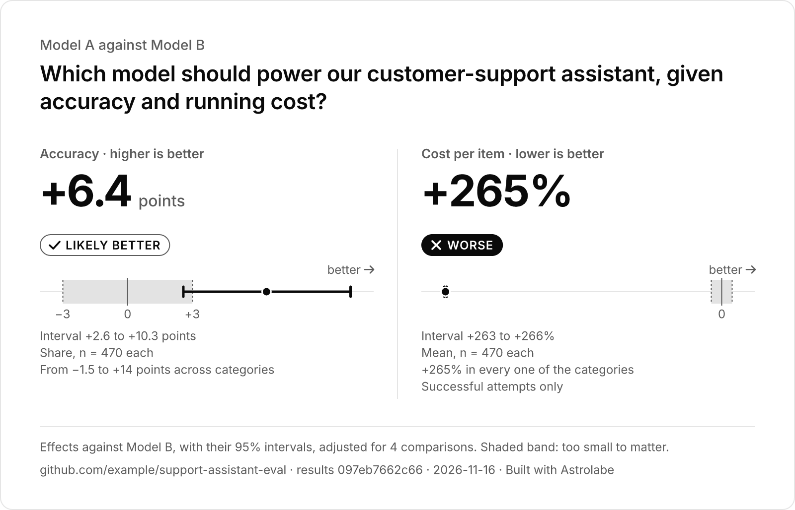

# Which model should power our customer-support assistant, given accuracy and running cost?

Internal tasks only; does not measure latency or safety.

<picture>
  <source media="(prefers-color-scheme: light)" srcset="exports/readme-card-light.svg">
  <source media="(prefers-color-scheme: dark)" srcset="exports/readme-card-dark.svg">
  
</picture>

Benchmark `support-assistant-eval`, version 1.2.0. Baseline: Model B.

## Results

### Accuracy

Share of items answered correctly, each item averaged over its 5 repeats. The share, in %; higher is better. Intervals: 95%, by bootstrap, resampling items and t. Failed attempts count as zero.

| Node | Candidate | Share (%) | 95% interval | n | Failures |
| --- | --- | ---: | ---: | ---: | ---: |
| Support assistant eval | Model B (baseline) | 58 | 55 to 62 | 470 | 10 in total |
| Support assistant eval | Model A | 65 | 62 to 68 | 470 | 1 in total |
| &emsp;Reasoning | Model B (baseline) | 72 | 69 to 75 | 350 | 0 |
| &emsp;Reasoning | Model A | 71 | 67 to 74 | 350 | 1 in total |
| &emsp;&emsp;Math word problems | Model B (baseline) | 71 | 67 to 75 | 200 | 0 |
| &emsp;&emsp;Math word problems | Model A | 73 | 69 to 77 | 200 | 0 |
| &emsp;&emsp;Policy questions | Model B (baseline) | 73 | 68 to 77 | 150 | 0 |
| &emsp;&emsp;Policy questions | Model A | 68 | 64 to 73 | 150 | 1 of 750 |
| &emsp;Coding | Model B (baseline) | 45 | 39 to 51 | 120 | 10 in total |
| &emsp;Coding | Model A | 59 | 54 to 65 | 120 | 0 |
| &emsp;&emsp;Bug fixes | Model B (baseline) | 45 | 39 to 51 | 120 | 10 of 600 |
| &emsp;&emsp;Bug fixes | Model A | 59 | 54 to 65 | 120 | 0 |

### Cost per item

API cost per item, computed by the eval script from token counts and the list price. The mean, in USD; lower is better. Intervals: 95%, by bootstrap, resampling items and t. Failed attempts are left out: values cover successful attempts only.

| Node | Candidate | Mean (USD) | 95% interval | n | Failures |
| --- | --- | ---: | ---: | ---: | ---: |
| Support assistant eval | Model B (baseline) | 0.001195 | 0.001189 to 0.001201 | 470 | 10 in total |
| Support assistant eval | Model A | 0.004355 | 0.004334 to 0.004376 | 470 | 1 in total |
| &emsp;Reasoning | Model B (baseline) | 0.001196 | 0.001189 to 0.001202 | 350 | 0 |
| &emsp;Reasoning | Model A | 0.004359 | 0.004334 to 0.004383 | 350 | 1 in total |
| &emsp;&emsp;Math word problems | Model B (baseline) | 0.001195 | 0.001186 to 0.001203 | 200 | 0 |
| &emsp;&emsp;Math word problems | Model A | 0.004353 | 0.004321 to 0.004384 | 200 | 0 |
| &emsp;&emsp;Policy questions | Model B (baseline) | 0.001197 | 0.001187 to 0.001208 | 150 | 0 |
| &emsp;&emsp;Policy questions | Model A | 0.004367 | 0.004329 to 0.004405 | 150 | 1 of 750 |
| &emsp;Coding | Model B (baseline) | 0.001191 | 0.001178 to 0.001204 | 120 | 10 in total |
| &emsp;Coding | Model A | 0.004342 | 0.004297 to 0.004387 | 120 | 0 |
| &emsp;&emsp;Bug fixes | Model B (baseline) | 0.001191 | 0.001178 to 0.001204 | 120 | 10 of 600 |
| &emsp;&emsp;Bug fixes | Model A | 0.004342 | 0.004297 to 0.004387 | 120 | 0 |

## Against Model B

Each candidate against the baseline, Model B. A verdict is read from the interval of the effect and the smallest difference that matters to the author: better or worse when the interval lies past it, likely when the direction is clear but the size may fall short, equivalent when the interval lies inside it, inconclusive otherwise. These are the claims of the benchmark. Their intervals are widened together for the 4 comparisons (Bonferroni), so they hold jointly.

| Comparison | Effect | Interval | Verdict | Notes |
| --- | ---: | ---: | --- | --- |
| Model A, accuracy, Support assistant eval | +6.4 points | +2.6 to +10.3 points (98.75%) | likely better |  |
| Model A, accuracy, Reasoning | −1.5 points | −4.9 to +2.0 points (98.75%) | inconclusive |  |
| Model A, accuracy, Coding | +14 points | +7 to +21 points (98.75%) | better |  |
| Model A, cost per item, Support assistant eval | +265% | +263 to +266% (98.75%) | worse | successful attempts only |

### Exploratory comparisons

Not declared before measuring and not adjusted for the number of comparisons: some of these verdicts can appear by chance, and none is a claim of the benchmark.

| Comparison | Effect | Interval | Verdict | Notes |
| --- | ---: | ---: | --- | --- |
| Model A, accuracy, Math word problems | +1.2 points | −1.9 to +4.3 points (95%) | inconclusive |  |
| Model A, accuracy, Policy questions | −4.1 points | −8.8 to +0.5 points (95%) | inconclusive |  |
| Model A, accuracy, Bug fixes | +14 points | +9 to +20 points (95%) | better |  |
| Model A, cost per item, Reasoning | +265% | +264 to +266% (95%) | worse | successful attempts only |
| Model A, cost per item, Coding | +265% | +263 to +266% (95%) | worse | successful attempts only |
| Model A, cost per item, Math word problems | +264% | +263 to +266% (95%) | worse | successful attempts only |
| Model A, cost per item, Policy questions | +265% | +263 to +266% (95%) | worse | successful attempts only |
| Model A, cost per item, Bug fixes | +265% | +263 to +266% (95%) | worse | successful attempts only |

## Method

- Computed from raw data by astrolabe: Accuracy, Cost per item.
- Comparisons: 4 primary, 8 exploratory.
- Observed: item 470 (planned 470); repeat 5 (planned 5).
- Order: randomized per repeat.
- Declared conditions: non deterministic, trained or tuned.
- Workload: 470 items written in-house from real support tickets. one item per request, no conversation history.
- Judge: Judge Model C (family provider-z); rubric with a reference answer; blind to the candidate; order: one answer graded at a time; no pairwise order; checked against human ratings: alpha 0.81 on 120 items.
- Items: private, not published; risk that a candidate has seen them: low.

### Candidates

Declared by the author.

**Model A**, version 2026-10-01

- Configuration: temperature 0.7; max output tokens 2048; prompt template support-v3
- Publication terms: provider terms of service, 2026-10, read at https://example.com/model_a/terms on 2026-11-02. Restriction on publishing results: none found
- Variants tried: support-v2, support-v3; kept: support-v3, measured again on fresh runs
- Family: provider-x
- Service: region eu-west, plan pay as you go, version 2026-10-01
- Price: per token; source: public price page, read on 2026-11-02

**Model B (baseline)**, version 2026-09-15

- Configuration: temperature 0.7; max output tokens 2048; prompt template support-v3
- Publication terms: provider terms of service, 2026-08, read at https://example.com/model_b/terms on 2026-11-02. Restriction on publishing results: none found
- Variants tried: support-v2, support-v3; kept: support-v3, measured again on fresh runs
- Family: provider-y
- Service: region eu-west, plan pay as you go, version 2026-09-15
- Price: per token; source: public price page, read on 2026-11-02

### Environment

- Client: One VM in eu-west
- Software: internal-eval 0.9.2

### Limitations

- Two candidates only; prices change often (usage kept for recomputing costs).
- Policy questions are graded by a model judge, validated on 120 human-rated items.

---

results sha256 `05f4d1ab3e99` · 2026-11-16 · source https://github.com/example/support-assistant-eval · built with astrolabe-bench 0.1.0
